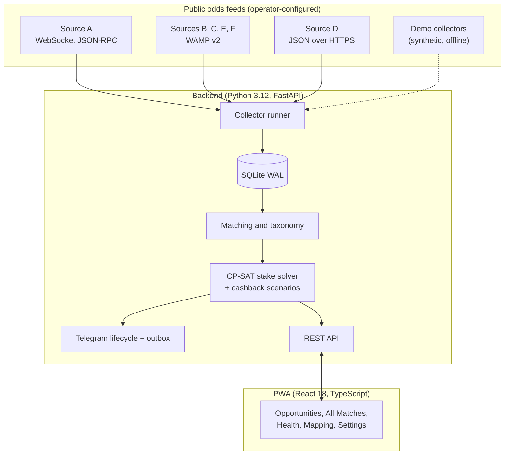

# Surebet Analyzer

[](https://python.org)
[](https://fastapi.tiangolo.com)
[](https://reactjs.org)
[](https://typescriptlang.org)
[](https://developers.google.com/optimization)
[](LICENSE)

Surebet Analyzer reads public, anonymous pre-match odds from several sportsbook
protocols, matches the same fixture across sources, and computes whether a stake
split across them would give a positive net difference in every outcome. All money is integer kuruş.
Results are served by a FastAPI backend to a mobile-first React PWA and,
optionally, as per-user Telegram alerts.

> [!IMPORTANT]
> **Read-only by design.** The application never places bets, never logs in to a
> sportsbook account, never moves money, and never claims bonuses. It only reads
> public odds and does the math.

> [!NOTE]
> **Anonymised sources.** This public snapshot names its data sources *Source A–F*
> and ships **no provider hostnames, URLs or account identifiers**. Taxonomy and
> operator ids in the repository are synthetic. Run it in [demo mode](#demo-mode)
> to see the full UI with generated data.

---

## Features

- **Protocol adapters.** Async collectors for three public feed families:
  a WebSocket JSON-RPC feed, a WAMP v2 feed over WebSocket and an anonymous
  JSON-over-HTTPS API. Each source runs in its own isolation
  boundary: one failing source is recorded on the health page and never stops
  the others.
- **Exact stake allocation.** The live scan allocates 1X2, Over/Under 2.5 and
  basketball moneyline stakes with a closed-form max-min split followed by a
  one-kuruş integer repair; an OR-Tools CP-SAT model solves the same problem
  exactly for manual analysis and as a cross-check. Money is integer kuruş,
  percentages are basis points, odds are `Decimal`; no float touches an amount.
- **Cashback modelling.** Conditional loss-refund terms are evaluated per coupon,
  so the app shows both the plain and the cashback-adjusted worst-case net difference.
- **Cross-source matching.** Team-name normalisation (Turkish characters,
  sponsor suffixes, aliases), kickoff tolerance and a curated registry of tracked
  competitions resolve one fixture across feeds that name it differently.
- **Taxonomy admin.** Provider competitions are mapped to canonical leagues
  automatically where the evidence is structured, and queued for review where it
  is not (approve, link, create, rename, undo).
- **PWA.** React 18, Vite, TypeScript, Tailwind and TanStack Query; installable,
  with an offline banner. Pages: Opportunities, All Matches, opportunity detail
  with stake split and per-outcome scenarios, Sources health, Mapping admin,
  Settings, Accounting.
- **Telegram alerts.** A lifecycle state machine (new, active, near threshold,
  stale, closed) with coarsened render fingerprints keeps each opportunity to one
  live message that is edited instead of re-sent. An in-chat calculator handles
  fixed-stake and hedge ("kurtar") requests.
- **Security.** Argon2id password hashing, session cookies with CSRF
  double-submit tokens, per-peer login rate limiting, invite-code registration.

## Architecture



Deeper write-ups live in [`docs/architecture/`](docs/architecture).

---

## Quickstart

Requirements: Python 3.12 with [`uv`](https://github.com/astral-sh/uv), Node.js 20+.

```bash
git clone https://github.com/ozgurlook/surebet-analyzer.git
cd surebet-analyzer
uv sync --extra dev
cd frontend && npm ci && npm run build && cd ..
```

### Demo mode

Demo mode swaps every source for a deterministic fake collector. Nothing is
fetched from the network. A login is created for you.

```bash
uv run surebet-web serve --demo --db demo.db
```

Open `http://127.0.0.1:8000` and log in as **`demo`** with the one-time password the
server prints on start (it changes on every start). Most
fixtures show the negative margin of a normal market on *All Matches*; a handful
carry a deliberate mispricing and appear under *Opportunities*.

### Running against real feeds

Copy `.env.example` to `.env`, set `SUREBET_REGISTRATION_CODE`, and give each
source you want to collect an endpoint:

| Variable | Meaning |
|---|---|
| `SUREBET_SOURCE_X_ENDPOINT` | `wss://` or `https://` feed URL (required for that source) |
| `SUREBET_SOURCE_X_ORIGIN` | Origin header (defaults to the endpoint host) |
| `SUREBET_SOURCE_X_PAGE_URL` | Public page that hands out anonymous tokens (Source D) |
| `SUREBET_SOURCE_X_REALM` | WAMP-feed sources only |
| `SUREBET_SOURCE_X_OPERATOR_ID` | WAMP operator id; for Source A, the JSON-RPC site id |

`X` is `A` to `F`. A source without an endpoint is shown as
"endpoint not configured" on the health page. Then:

```bash
uv run surebet-web serve --db surebet.db
```

Register from the login screen with your registration code. The server serves
the built PWA from `frontend/dist`.

### One-shot collector CLIs

```bash
uv run collect-source-a once
uv run collect-source-d once
uv run collect-wamp once --source source_b
uv run analyze-manual --help          # offline arbitrage calculator
uv run preview-notifications --help   # render sample Telegram cards
```

---

## Development

```bash
uv run pytest -o pythonpath=.     # backend: unit, property, integration, acceptance
uv run ruff check . && uv run ruff format --check .
uv run mypy src                   # strict
cd frontend && npm test && npm run build
```

CI runs the same checks on every push and pull request
([`.github/workflows/ci.yml`](.github/workflows/ci.yml)). Docker Compose and Caddy
files for a single-VM deployment are described in
[`docs/deployment.md`](docs/deployment.md).

---

## ⚖️ Yasal Uyarı / Legal Notice

> [!CAUTION]
> **Türkçe**
>
> Surebet Analyzer yalnızca eğitim, yazılım geliştirme ve veri analizi amacıyla geliştirilmiş kişisel bir mühendislik projesidir; bir bahis veya şans oyunu hizmeti değildir.
>
> - Geliştirici olarak bahis veya şans oyunu oynamıyorum, kimseye oynatmıyorum ve kimseyi bunlara teşvik etmiyorum.
> - Uygulama bahis almaz, oynamaz veya oynatmaz; kupon oluşturmaz ya da iletmez; ödeme veya para transferi yapmaz ve hiçbir oyuncu hesabına erişmez.
> - Yalnızca herkese açık, anonim oran verilerini salt okunur biçimde toplar ve bunları algoritma ile veri eşleştirme tekniklerini incelemek için kullanır.
> - Proje hiçbir bahis şirketiyle bağlantılı değildir; kaynak adları anonimleştirilmiştir ve depo herhangi bir siteye erişim adresi veya bağlantısı içermez.
> - Hesaplamalar ve örnekler bahis, yatırım veya finansal tavsiye değildir ve hiçbir kazanç vaadi içermez.
> - Türkiye'de izinsiz bahis ve şans oyunlarını oynamak, oynatmak, bunlara yer ve imkân sağlamak ve reklamını yapmak 7258 sayılı Futbol ve Diğer Spor Müsabakalarında Bahis ve Şans Oyunları Düzenlenmesi Hakkında Kanun kapsamında yasaktır. Bu proje bu tür faaliyetlere aracılık etmek veya bunları desteklemek için tasarlanmamıştır ve bu amaçla kullanılamaz.
> - Kodu veya çıktılarını kullanan herkes, yürürlükteki mevzuata ve üçüncü taraf sitelerin kullanım koşullarına uymaktan kendisi sorumludur.
>
> **English**
>
> Surebet Analyzer is a personal engineering project built only for education, software development, and data analysis; it is not a betting or gambling service.
>
> - As the developer, I do not gamble, I do not let anyone gamble through this project, and I do not encourage gambling.
> - The application does not take, place, or broker bets; does not create or submit bet slips; does not make payments or move money; and does not access any player account.
> - It only reads public, anonymous odds data to study algorithms and data matching.
> - The project is not affiliated with any bookmaker; source names are anonymised and the repository contains no addresses of, or links to, any betting site.
> - Calculations and examples are not betting, investment, or financial advice and promise no profit.
> - In Turkey, playing, organising, facilitating, or advertising unlicensed betting and games of chance is prohibited under Law No. 7258. This project is not designed to broker or support such activity and must not be used for it.
> - Anyone using the code or its output is responsible for complying with applicable law and the terms of service of third-party websites.
> - The software is provided "AS IS", without warranty of any kind, express or implied.

---

## License

[MIT](LICENSE) © 2026 Özgür Karakaya
