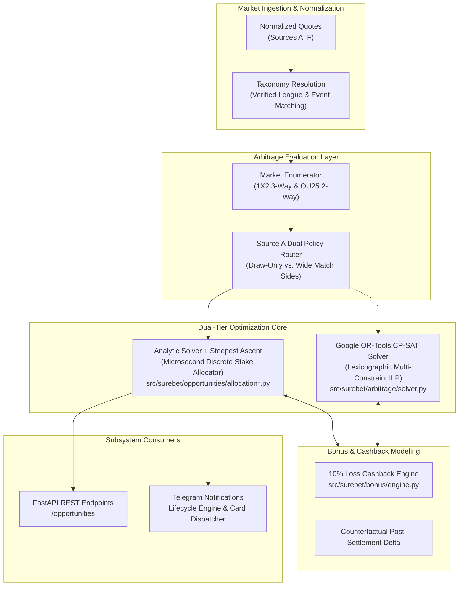
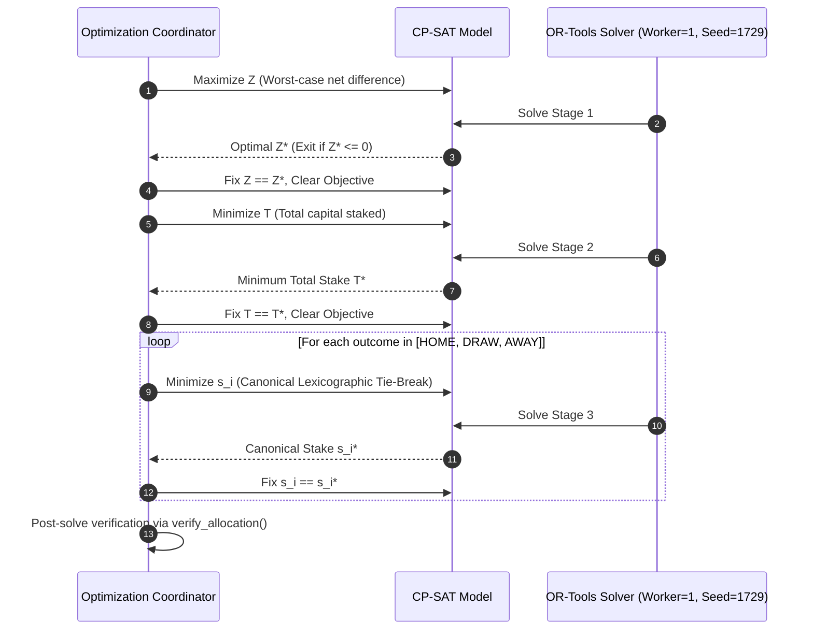
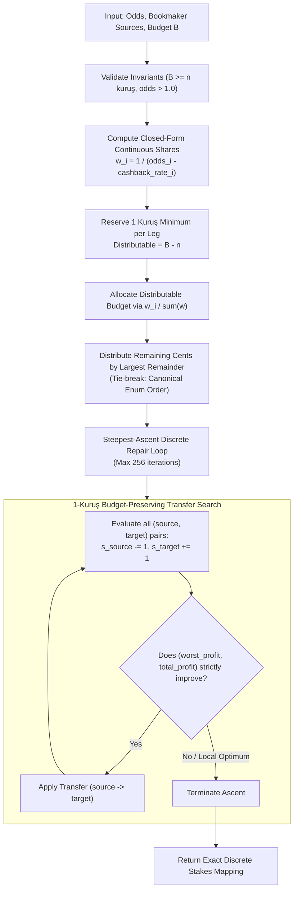
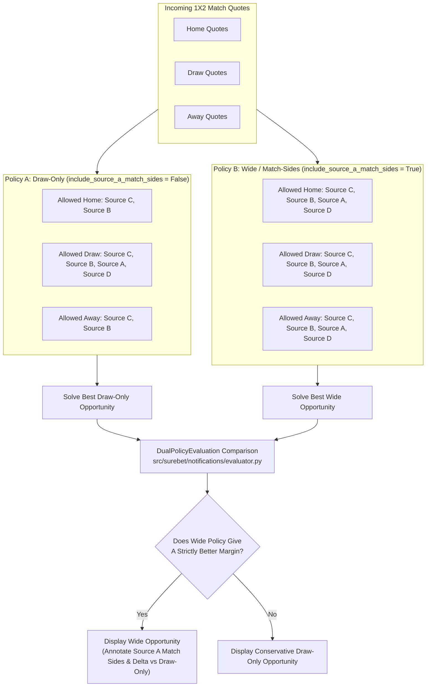
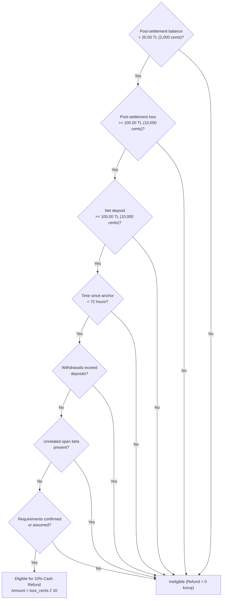
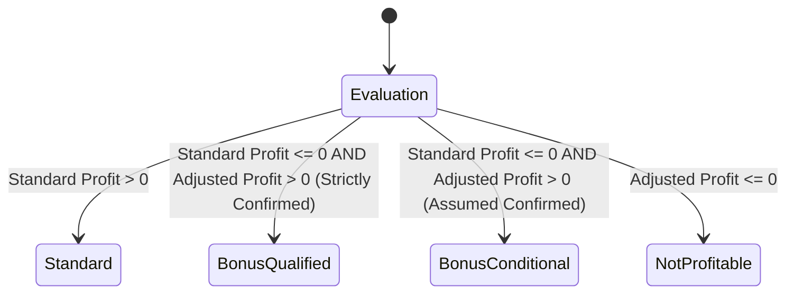
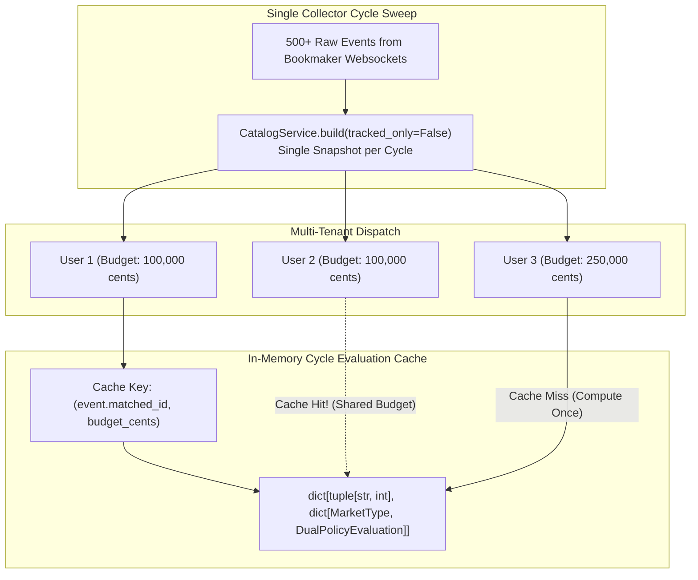

# Arbitrage & Solver Subsystem Guide (`docs/architecture/01-arbitrage-and-solver.md`)

> **Subsystem Role:** Real-time mathematical arbitrage identification, discrete stake distribution optimization, and bonus-adjusted margin calculation under bookmaker-specific constraints.

---

## 1. Architectural Overview & System Role

The `surebet-analyzer` platform operates a dual-tier calculation pipeline designed to detect sports arbitrage opportunities and compute exact, executable stake distributions across disparate bookmaker platforms.



### 1.1 Pure Analytical Decision-Support Boundary (Zero-Bet Invariant)

As mandated by [AGENTS.md](../../AGENTS.md), this subsystem is strictly an **analytical calculator and decision-support tool**.

- **Read-Only Posture:** The solver ingests market data, verifies arbitrage viability, and calculates stake distributions for manual review by human operators.
- **Strict Boundary:** Under no circumstances does the solver or any associated module communicate with bookmaker wagering APIs, place automated bets, manipulate account sessions, or execute monetary transfers.

---

## 2. Mathematical Formulation & Optimization Engines

Arbitrage calculation must navigate between theoretical continuous mathematics and practical, discrete integer constraints imposed by bookmaker systems.

### 2.1 Continuous Arbitrage Foundation

In an idealized frictionless market with $n$ mutually exclusive and exhaustive outcomes where outcome $i$ offers decimal odds $o_i \in \mathbb{R}_{>1}$, the market inverse-odds sum $S$ is defined as:

$$S = \sum_{i=1}^{n} \frac{1}{o_i}$$

An arbitrage condition exists if and only if $S < 1.0$. Given total bankroll $B$, the continuous theoretical stake $s_i^*$ allocated to outcome $i$ to give an equal payout $P$ across all outcomes is:

$$s_i^* = \frac{B}{o_i \cdot S} \quad \implies \quad P = s_i^* \cdot o_i = \frac{B}{S} > B$$

Theoretical net margin is:

$$\text{Margin} = \frac{1 - S}{S}$$

### 2.2 Discrete Integer Linear Programming (ILP) Formulation

In real-world betting, theoretical continuous stakes cannot be wagered. Stakes must be discrete integer cents (kuruş), payouts are truncated downward by bookmaker clearing systems, and bookmakers impose per-account balance, minimum stake, and maximum payout limits.

The exact discrete optimization problem is formulated as an Integer Linear Program solved via Google OR-Tools CP-SAT in [`src/surebet/arbitrage/solver.py`](../../src/surebet/arbitrage/solver.py).

#### Decision Variables
- $s_i \in \mathbb{Z}_{\ge 0}$: Integer stake allocated to outcome $i$ in kuruş ($1\text{ TL} = 100\text{ cents}$).
- $g_i \in \mathbb{Z}_{\ge 0}$: Gross payout for outcome $i$ in kuruş.
- $Z \in \mathbb{Z}$: Worst-case net difference across all outcomes.
- $T = \sum_{i=1}^n s_i$: Total capital staked across all legs.

#### Constraints
1. **Scaled Odds Division Equality:**
   To eliminate floating-point imprecision, decimal odds $o_i$ (quantized to 4 decimal places) are scaled by $K = 10{,}000$:
   
   $$\text{scaled\_odds}_i = \text{round}(o_i \times K) \in \mathbb{Z}^+$$
   
   Gross payout integer equality is enforced using integer division:
   
   $$g_i = \left\lfloor \frac{s_i \cdot \text{scaled\_odds}_i}{K} \right\rfloor$$
   
   Implemented in CP-SAT via `model.add_division_equality(gross_var, stake * scaled_odds[outcome], ODDS_SCALE)`.

2. **Per-Outcome Stake Bounds:**
   Each outcome leg is bound by the source account's configured limits:
   
   $$m_i \le s_i \le M_i$$
   
   where $m_i = \text{min\_stake\_cents}_i$ and $M_i = \min(\text{max\_stake\_cents}_i, \text{balance\_cents}_i, B)$.

3. **Maximum Payout Ceilings:**
   If a bookmaker imposes a maximum payout cap $P_{\max, i}$:
   
   $$g_i \le P_{\max, i}$$

4. **Total Budget & Bookmaker Balance Constraints:**
   
   $$\sum_{i=1}^n s_i \le B$$
   
   For each distinct bookmaker source $k \in \mathcal{K}$:
   
   $$\sum_{i \in \text{Legs}(k)} s_i \le \text{balance}_k$$

5. **Worst-Case Net Difference Bound:**
   
   $$\forall i \in \{1, \dots, n\}: \quad Z \le g_i - T + \Delta_i^{\text{bonus}}$$

#### Lexicographic Multi-Stage Objective

A single-pass optimization may produce non-deterministic or capital-inefficient allocations. `surebet-analyzer` implements a **multi-stage lexicographic optimization**:



1. **Stage 1: Maximize Minimum Profit:** $\max Z$. Determines the highest achievable worst-case return $Z^*$.
2. **Stage 2: Minimize Total Capital:** Fix $Z = Z^*$, then $\min T$. Preserves liquidity by wagering only the minimal total capital required to reach $Z^*$.
3. **Stage 3: Lexicographic Outcome Tie-Breaking:** Sequentially minimize $s_{\text{HOME}}$, then $s_{\text{DRAW}}$, then $s_{\text{AWAY}}$ subject to prior invariants. This produces a strictly deterministic allocation regardless of solver execution platform.

---

## 3. Financial Invariants & Money Arithmetic

Financial precision is governed by strict mathematical invariants documented in [AGENTS.md](../../AGENTS.md) and implemented in [`src/surebet/money.py`](../../src/surebet/money.py).

### 3.1 Strict Integer Kuruş / Cents
- **Zero Floating-Point Money:** Python `float` is strictly forbidden for money, stakes, payouts, or balance tracking.
- All monetary values are represented as native signed integers in kuruş (`int`):
  - $1.00\text{ TRY} = 100\text{ cents}$
  - `budget_cents: int`
  - `stake_cents: int`
  - `payout_cents: int`
  - `gross_return_cents: int`

### 3.2 Percentage Representation in Basis Points (`profit_bps`)
Margins are expressed in integer basis points (`profit_bps: int`):

$$1\text{ bps} = 0.01\% = 0.0001$$

$$\text{profit\_bps} = \left\lfloor \frac{\text{net\_profit\_cents} \times 10{,}000}{\text{budget\_cents}} \right\rfloor$$

Examples:
- $+2.50\%$ margin $\to 250\text{ bps}$
- $+0.85\%$ margin $\to 85\text{ bps}$
- $+12.00\%$ margin $\to 1{,}200\text{ bps}$

### 3.3 Decimal Odds Validation & Quantization
Bookmaker odds must satisfy strict constraints before entering the solver:
- Type: Python `Decimal` or `Fraction`.
- Lower Bound: Strictly greater than $1.00$ (`odds > Decimal("1.00")`).
- Quantization: Maximum 4 fractional decimal digits (`exponent >= -4`).
- Scaling: Scaled by $10{,}000$ to map odds into exact integer space without floating-point inaccuracies (`odds_scaled(odds, scale=10_000)`).

Exact conservative kuruş payout calculation via `src/surebet/money.py`:

```python
def payout_cents(stake_cents: int, odds: Decimal) -> int:
    """Return a stake's payout in kuruş, rounding down to the kuruş."""
    value = validate_odds(odds)
    payout = Fraction(stake_cents) * Fraction(value)
    return payout.numerator // payout.denominator
```

---

## 4. Supported Markets & High-Throughput Allocation

The platform supports both 3-way and 2-way sports betting markets. For real-time catalog scanning (hundreds of live matches per second), relying solely on CP-SAT MILP solves introduces computational latency. The platform implements an ultra-fast analytic seeding and bounded steepest-ascent integer repair algorithm.

### 4.1 Market Structure & Coverage Invariants

| Market Type | Domain Enum | Outcomes | Mutual Exclusivity Rule |
|---|---|---|---|
| **Match Winner (1X2)** | `MarketType.FULL_TIME_RESULT` | `Outcome.HOME`<br>`Outcome.DRAW`<br>`Outcome.AWAY` | Exactly one outcome wins at full-time (90 min + injury time). |
| **Over / Under 2.5** | `MarketType.TOTAL_GOALS_25` | `TwoWayOutcome.OVER`<br>`TwoWayOutcome.UNDER` | Exactly one outcome wins (total goals $\ge 3$ or $\le 2$). |

### 4.2 Analytic Allocation with Steepest-Ascent Integer Repair

Implemented in [`src/surebet/opportunities/allocation.py`](../../src/surebet/opportunities/allocation.py) (3-way) and [`src/surebet/opportunities/allocation_2way.py`](../../src/surebet/opportunities/allocation_2way.py) (2-way).



#### Algorithm Steps:
1. **Closed-Form Continuous Seeding:**
   With potential loss cashback rate $c_i \in \{0, 0.10\}$, equalizing scenario net profits establishes the weighting:
   
   $$w_i = \frac{1}{\frac{\text{scaled\_odds}_i}{K} - c_i}$$

2. **Feasible Minimum Reservation:**
   Reserve $1\text{ kuruş}$ per leg ($\text{Distributable} = B - n$). This ensures no outcome receives zero stake.
3. **Largest-Remainder Flooring:**
   Allocate $\lfloor \text{Distributable} \times \frac{w_i}{\sum w} \rfloor$. Assign remaining fractional cents in descending order of remainder, using `Outcome` enum declaration order to break exact ties.
4. **Bounded Steepest-Ascent Discrete Repair:**
   Explore all budget-neutral 1-kuruş transfers ($s_{\text{src}} \leftarrow s_{\text{src}} - 1$, $s_{\text{dst}} \leftarrow s_{\text{dst}} + 1$). If an exchange strictly increases lexicographic tuple $(\text{worst\_profit\_cents}, \text{total\_profit\_cents})$, the move is accepted.
   The process terminates at a local optimum or after a maximum iteration bound (`_MAX_REPAIR_STEPS = 256` for 3-way, `128` for 2-way). Real-world inputs converge in 2–5 steps.

---

## 5. Source A Dual Policy Strategy

Source A runs on a WebSocket JSON-RPC feed and Source D is a second sportsbook backend (JSON over HTTPS) of the same operator, while Source C and Source B run on WAMP feeds. Due to platform liquidity and account limits on Source A match sides, the system operates two distinct operational policies.



### 5.1 Policy Definitions
1. **Draw-Only Policy (`include_source_a_match_sides = False`):**
   - **Rationale:** Protects user bankroll from limits or late cancellations on home/away outrights at Source A.
   - **Rule:** Source A / Source D is strictly restricted to `Outcome.DRAW`.
   - `Outcome.HOME` and `Outcome.AWAY` must be filled by WAMP-feed sources (`Source.SOURCE_C`, `Source.SOURCE_B`).
2. **Wide Policy (`include_source_a_match_sides = True`):**
   - **Rationale:** Discovers higher-margin arbitrage opportunities when the user is willing to wager on match sides at Source A.
   - **Rule:** Source A / Source D can take any leg (`HOME`, `DRAW`, or `AWAY`).

### 5.2 Independent Operator Invariant
Under both policies, bets cannot be hedged entirely within the same operator group. Source C and Source B share the WAMP-feed backend (`OperatorGroup.SOURCE_B_C`). Wagering across Source C and Source B is a single-counterparty exposure, not an arbitrage hedge. Every opportunity must span at least two distinct operator groups (e.g., WAMP feed + Source A, or WAMP feed + Source E).

### 5.3 Dual Policy Evaluation Structure (`DualPolicyEvaluation`)
Evaluated in [`src/surebet/notifications/evaluator.py`](../../src/surebet/notifications/evaluator.py):

```python
class DualPolicyEvaluation(BaseModel):
    matched_id: str
    market_type: MarketType
    selected: CalculatedOpportunity
    draw_only: CalculatedOpportunity
    uses_source_a_match_sides: bool
    relevant_sources: frozenset[Source]
```

Selection between policies uses a deterministic key:

```python
def _selection_key(opportunity: CalculatedOpportunity) -> tuple[int, int, str]:
    return (
        -opportunity.min_adjusted_profit_cents,
        _source_a_match_side_count(opportunity),
        opportunity.opportunity_id,
    )
```

If the wide policy provides a superior net margin, the alert card displays the wide selection while detailing the conservative draw-only alternative and the exact match sides allocated to Source A.

---

## 6. Bonus & Conditional Cashback Modeling

Loss bonus recovery mechanics are integrated into both the CP-SAT model and the analytic solver.

### 6.1 Bonus Mechanics & Eligibility Criteria

Certain bookmakers (`Source.SOURCE_C`, `Source.SOURCE_B`) provide a direct 10% cash refund on net betting losses, settled without wagering rollover requirements. Evaluated in [`src/surebet/bonus/engine.py`](../../src/surebet/bonus/engine.py):



### 6.2 Counterfactual Post-Settlement Bonus Delta

The bonus delta $\Delta$ represents the marginal change in claimable bonus caused by an arbitrage execution:

$$\Delta(j) = \text{claimable\_bonus}(\text{State}_{\text{after}, j}) - \text{claimable\_bonus}(\text{State}_{\text{before}})$$

For outcome $j$:
- If leg $j$ wins at Bookmaker A, Bookmaker B incurs a loss: $\text{loss\_after}_B = \max(0, \text{loss\_before}_B + s_B)$.
- If eligible, Bookmaker B refunds cashback: $\lfloor \frac{\text{loss\_after}_B}{10} \rfloor$.
- In the high-throughput pipeline, cashback for losing eligible stakes is:
  
  $$\text{cashback}_j = \left\lfloor \frac{\sum_{k \ne j, k \in \{\text{Source C}, \text{Source B}\}} s_k \times 10}{100} \right\rfloor$$

### 6.3 Opportunity Classification Hierarchy

Arbitrage opportunities are categorized according to their dependency on bonus recovery:



1. **`STANDARD` (`OpportunityClass.STANDARD`):** Positive worst-case difference purely on odds ($Z_{\text{standard}} > 0$). Zero bonus reliance.
2. **`BONUS_QUALIFIED` (`OpportunityClass.BONUS_QUALIFIED`):** Profitable only after factoring verified bonus deltas ($Z_{\text{standard}} \le 0$ and $Z_{\text{adjusted}} > 0$ with `assume_confirmed=False`).
3. **`BONUS_CONDITIONAL` (`OpportunityClass.BONUS_CONDITIONAL`):** Profitable only if bonus requirements are assumed confirmed ($Z_{\text{standard}} \le 0$ and $Z_{\text{adjusted}} > 0$ with `assume_confirmed=True`).
4. **`NOT_PROFITABLE` (`OpportunityClass.NOT_PROFITABLE`):** Unprofitable across all counterfactual scenarios.

---

## 7. Performance Optimizations & Cycle Memoization

Real-time price discovery runs continuously. A single collection cycle can encounter 500+ events across multiple bookmakers, consumed simultaneously by the REST API, mobile PWA, and multiple multi-tenant Telegram subscribers.

### 7.1 Multi-Tier Caching & Memoization Architecture



1. **Single Catalog Snapshot per Cycle:**
   `CatalogService.build(now, tracked_only=False)` executes once per collection cycle. Per-user preferences (tracked leagues, country exclusions) are evaluated in-memory over the same snapshot rather than rebuilding the catalog per subscriber.
2. **Cycle-Scoped Memoization:**
   In [`TelegramNotificationService.evaluate_cycle()`](../../src/surebet/notifications/service.py), evaluations are memoized by:
   
   $$\text{Key} = (\text{event.matched\_id}, \text{budget\_cents})$$
   
   Subscribers sharing the standard default budget ($1{,}000.00\text{ TL} = 100{,}000\text{ cents}$) reuse cached calculations, eliminating redundant solver executions across the entire user base.
3. **HTTP ETag Conditional Queries:**
   In [`src/surebet/web/routes/opportunities.py`](../../src/surebet/web/routes/opportunities.py), the `/opportunities` route computes an ETag from the catalog snapshot version and user filter hashes:
   
   $$\text{ETag} = \text{SHA-256}(\text{snapshot.version\_tag} : \text{user\_id} : \text{budget} : \text{filters})[:16]$$
   
   Returns `HTTP 304 Not Modified` when market odds have not changed, reducing serialization and bandwidth consumption.

---

## 8. File Map & Code References

| Subsystem Component | Repository Path | Primary Responsibility |
|---|---|---|
| **CP-SAT Solver** | [`src/surebet/arbitrage/solver.py`](../../src/surebet/arbitrage/solver.py) | Discrete ILP solver (`optimize_standard`, `optimize_adjusted`) using OR-Tools. |
| **Domain Models** | [`src/surebet/domain/models.py`](../../src/surebet/domain/models.py) | Data contracts (`Quote`, `Allocation`, `ScenarioResult`, `Opportunity`). |
| **Domain Enums** | [`src/surebet/domain/enums.py`](../../src/surebet/domain/enums.py) | Market enums (`MarketType`, `Outcome`, `TwoWayOutcome`, `Source`, `OperatorGroup`). |
| **Money Arithmetic** | [`src/surebet/money.py`](../../src/surebet/money.py) | Integer cents conversions, odds validation, kuruş payout math. |
| **Analytic 3-Way Allocation** | [`src/surebet/opportunities/allocation.py`](../../src/surebet/opportunities/allocation.py) | Microsecond 3-way stake allocator with bounded steepest-ascent repair. |
| **Analytic 2-Way Allocation** | [`src/surebet/opportunities/allocation_2way.py`](../../src/surebet/opportunities/allocation_2way.py) | Microsecond 2-way stake allocator (OU25) with steepest-ascent repair. |
| **Opportunity Strategy** | [`src/surebet/opportunities/strategy.py`](../../src/surebet/opportunities/strategy.py) | Assignment enumeration, cashback modeling, `CalculatedOpportunity`. |
| **Dual Policy Evaluator** | [`src/surebet/notifications/evaluator.py`](../../src/surebet/notifications/evaluator.py) | `evaluate_event_by_market`, `choose_policy`, `DualPolicyEvaluation`. |
| **Bonus Engine** | [`src/surebet/bonus/engine.py`](../../src/surebet/bonus/engine.py) | Loss bonus eligibility, period anchor checks, `bonus_delta` calculation. |
| **Verification Module** | [`src/surebet/arbitrage/verify.py`](../../src/surebet/arbitrage/verify.py) | Independent integer-kuruş scenario verification (`verify_allocation`). |
| **Arbitrage Unit Tests** | [`tests/unit/arbitrage/`](../../tests/unit/arbitrage/) | Unit tests for solver, math precision, scenarios, and bonus solver. |
| **Opportunity Unit Tests** | [`tests/unit/opportunities/`](../../tests/unit/opportunities/) | Tests for analytic allocators, 2-way strategy, and dual policy selection. |

---

## 9. Related Documentation

- [AGENTS.md](../../AGENTS.md) — Single source of truth for AI agents and hard technical invariants.
- [02-telegram-notifications.md](02-telegram-notifications.md) — Telegram notification engine, card lifecycle state machine, and outbox dispatcher.
- [03-collectors-and-protocols.md](03-collectors-and-protocols.md) — Bookmaker protocol adapters (JSON-RPC, WAMP v2, JSON over HTTPS) and endpoint configuration.
- [04-taxonomy-and-matching.md](04-taxonomy-and-matching.md) — Entity resolution, team/league normalization, and fuzzy matching.
- [05-web-storage-security.md](05-web-storage-security.md) — FastAPI backend, SQLite WAL concurrency, and React PWA.
