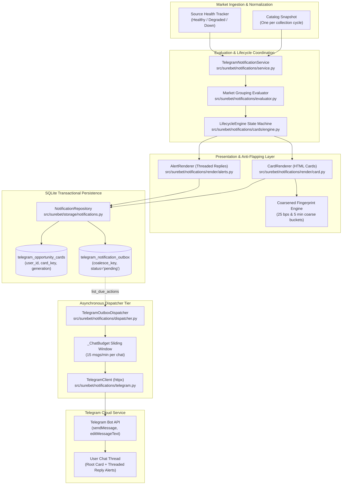
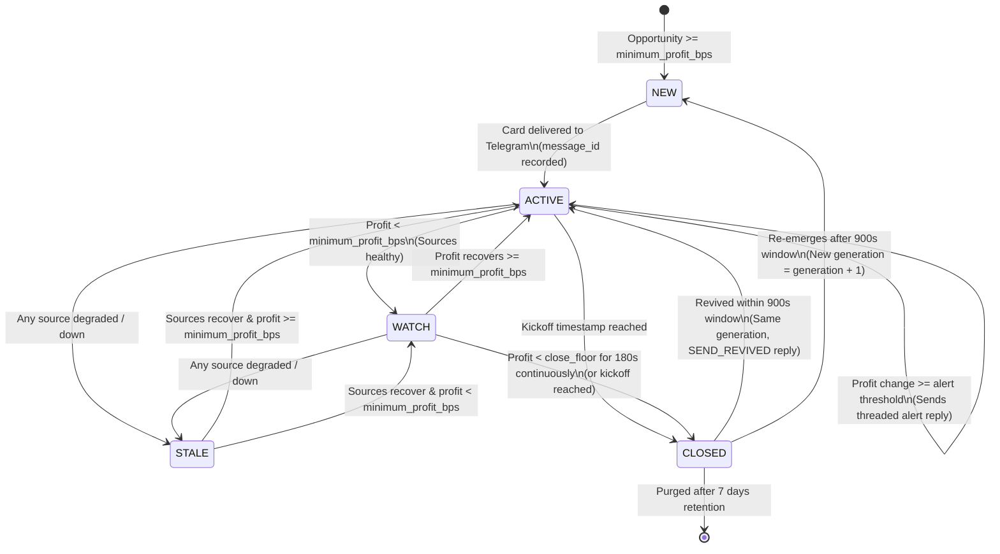

# Telegram Notifications Subsystem Guide (`docs/architecture/02-telegram-notifications.md`)

> **Subsystem Role:** Real-time multi-tenant opportunity tracking, idempotent lifecycle management, anti-flapping coalesced rendering, and rate-limited Telegram alert dispatching.

---

## 1. Architectural Overview & System Purpose

The `surebet-analyzer` Telegram notification engine is a high-throughput, multi-tenant alerting subsystem. It continuously reconciles identified arbitrage opportunities against personalized user criteria, manages the stateful progression of each opportunity via an idempotent state machine, suppresses alerting noise caused by microscopic odds fluctuations, and dispatches structured HTML cards and threaded alert replies to Telegram chats.



### 1.1 Strict Read-Only Analytical Policy (Zero-Bet Invariant)

As formally established in [AGENTS.md](../../AGENTS.md):
- **Decision-Support Only:** This notification engine exists exclusively to alert human operators to high-value, mathematically verified sports arbitrage opportunities.
- **Zero Automated Wagers:** The subsystem contains no mechanics, endpoints, or routines to place bets, initiate bookmaker wagers, authenticate against user wagering sessions, manipulate sportsbook balances, or process financial transactions.
- **Operator Agency:** The human operator retains full control over reviewing stakes, verifying bookmaker liquidity, and placing any wagers manually outside this software.

### 1.2 Subsystem Decoupling & Concurrency Design

The alerting architecture strictly decouples opportunity evaluation from network delivery:
1. **Synchronous Evaluation Cycle (`TelegramNotificationService`):**
   - Executes synchronously immediately following the catalog aggregation cycle.
   - Operates entirely in memory and against local SQLite tables.
   - Performs **zero network calls** and zero Telegram I/O, ensuring that Telegram API latency or outages never impede the real-time market collection loop.
   - Bundles all card updates and outbox actions for each user into a single atomic SQLite transaction (`apply_transitions`).
2. **Asynchronous Delivery Daemon (`TelegramOutboxDispatcher`):**
   - Operates as an independent background task (`asyncio.create_task`).
   - Polls the transactional outbox (`telegram_notification_outbox`) for due actions.
   - Enforces strict per-chat rate limiting (sliding window token bucket) to prevent HTTP 429 Too Many Requests errors.
   - Handles network timeouts, exponential backoff, dead-letter exhaustion, and message deletions gracefully without impacting other concurrent chats.

---

## 2. Card Identity & The 5-State Lifecycle State Machine

### 2.1 The Card Identity Model

In previous legacy iterations, cards were keyed solely by `(user_id, matched_id)`. When multiple markets existed for a single match (e.g., Full Time Result 1X2 and Total Goals 2.5 Over/Under), fluctuations would cause the card to hop across markets, mutating a 1X2 card into an Over/Under card and presenting misleading profit comparisons.

In the current architecture, a card tracks **exactly one market within one match** for a specific user and generation:
- **Card Key:** `card_key = f"{matched_id}:{market_type.value}"` (e.g., `"evt-49102:1X2"`, `"evt-49102:OU25"`).
- **Identity Triplet:** `(user_id, card_key, generation)`.
- **Multi-Market Autonomy:** If a match produces both a qualifying 1X2 opportunity and an Over/Under opportunity, two independent cards are created and managed in parallel. They are rendered, edited, alerted, and closed without cross-market interference.

### 2.2 The 5 Lifecycle States

The card lifecycle is governed by the pure state machine implemented in [`LifecycleEngine`](../../src/surebet/notifications/cards/engine.py):

| State | Status Enum | Definition & Entry Condition | Visual Indicator | Outbox Actions Produced |
|---|---|---|---|---|
| **`NEW`** | `LifecycleStatus.NEW` | Fresh opportunity meeting or exceeding user `minimum_profit_bps`. First appearance of the event+market. | 🟢 `YENİ FIRSAT` | `SEND_CARD` |
| **`ACTIVE`** | `LifecycleStatus.ACTIVE` | Established opportunity currently meeting or exceeding user `minimum_profit_bps`. Sources are healthy. | 🟢 `Aktif` | `EDIT_CARD`, optional `SEND_ALERT` |
| **`WATCH`** | `LifecycleStatus.WATCH` | Profit has dipped below `minimum_profit_bps`, but has not yet breached the close grace period. | 🟠 `Eşiğe yakın` | `EDIT_CARD` (silent update) |
| **`STALE`** | `LifecycleStatus.STALE` | One or more relevant bookmaker sources are degraded/unhealthy, or quote feed has stalled. | ⚪ `Veri bekleniyor` + ⚠️ Banner | `EDIT_CARD` (silent update) |
| **`CLOSED`** | `LifecycleStatus.CLOSED` | Opportunity collapsed below close floor for continuous grace period (180s), or match kicked off. | 🔴 `Kapandı` | `EDIT_CARD`, `SEND_CLOSED` |



### 2.3 Mathematical Thresholds & Transition Arithmetic

All lifecycle math is strictly computed using integer basis points (`bps`) in [`src/surebet/notifications/cards/thresholds.py`](../../src/surebet/notifications/cards/thresholds.py):

$$\text{profit\_bps} = \text{round}\left( \frac{\text{min\_adjusted\_profit\_cents} \times 10{,}000}{\text{budget\_cents}} \right)$$

Key thresholds and operational constants include:
- **`minimum_profit_bps`:** The user-configured percentage threshold (e.g., `95 bps = 0.95%`).
- **`CLOSE_FACTOR = 0.80`:** A hysteresis factor defining the close floor.
- **`close_floor_bps`:** Computed as:
  $$\text{close\_floor\_bps} = \text{round}(\text{minimum\_profit\_bps} \times 0.80)$$
  For a 100 bps threshold, the close floor is 80 bps. If profit oscillates between 80 bps and 99 bps, the card enters `WATCH` but **does not close** and does not start the closing grace timer.
- **`CLOSE_GRACE_SECONDS = 180` (3 minutes):** The opportunity must reside continuously below `close_floor_bps` for 180 consecutive seconds before transitioning to `CLOSED`. If profit rebounds above `close_floor_bps` for even a single cycle, `below_since` is reset to `None`.
- **`REVIVAL_WINDOW_SECONDS = 900` (15 minutes):** If a closed card's opportunity re-emerges above `minimum_profit_bps` within 15 minutes of closing (and prior to kickoff):
  - The card is **revived** in place: `generation` remains unchanged, `status` reverts to `ACTIVE`, `revival_count` increments by 1.
  - The card text is updated via `EDIT_CARD`, and a threaded reply `SEND_REVIVED` (`♻️ Yeniden açıldı`) is dispatched with `silent=True` (`disable_notification=True`).
  - If re-emergence occurs after the 15-minute revival window, the old card remains closed, and a brand new card is opened with `generation = prior.generation + 1`.

### 2.4 The Single-Anchor Movement Rule (Anti-Contradiction Rule)

A common flaw in naive notification systems is tracking separate peak and trough windows. This frequently leads to contradictory alerts (e.g., an "odds dropped" alert followed seconds later by an "odds rose" alert on the same match).

`LifecycleEngine` resolves this via the **Single-Anchor Invariant**:
- Each card maintains a single baseline reference: `anchor_bps`.
- At card inception, `anchor_bps` is set to the initial `first_profit_bps`.
- Profit movement $\Delta$ is calculated strictly against this single anchor:
  $$\Delta = \text{current\_profit\_bps} - \text{anchor\_bps}$$
- A movement alert (`SEND_ALERT`) is triggered if and only if all three conditions are satisfied:
  1. The card is delivered and has a valid `message_id`.
  2. The absolute movement meets the directional threshold:
     - If $\Delta > 0$: $\Delta \ge \text{increase\_threshold\_bps}$ (e.g., $\ge +20\text{ bps}$)
     - If $\Delta < 0$: $|\Delta| \ge \text{decrease\_threshold\_bps}$ (e.g., $\ge -20\text{ bps}$)
  3. Cooldown has elapsed: $\text{now} - \text{last\_alert\_at} \ge \text{alert\_cooldown\_seconds}$ (default 300s / 5 min).
- **Atomic Anchor Shift:** When an alert fires, `anchor_bps` is atomically set to `current_profit_bps`, and `last_alert_at` is set to `now`.
- **Mathematical Impossibility of Contradiction:** Because there is exactly one $\Delta$, the system can never emit both an increase and a decrease alert in the same cycle. During the cooldown period, the anchor remains locked, intermediate fluctuations are absorbed silently, and upon cooldown expiration, a single consolidated alert reports the net change.

### 2.5 Stale Data & Source Outage Invariants

Real-time sports data feeds can experience transient WebSocket disconnects or API degradation:
- **Relevant Sources:** `DualPolicyEvaluation.relevant_sources` tracks the set of bookmakers contributing odds to the selected arbitrage combination.
- **Source Health Monitoring:** The engine verifies that every relevant source has `SourceHealthStatus.HEALTHY`.
- **Freezing Invariant in `STALE`:**
  - If any relevant source degrades, the card transitions to `LifecycleStatus.STALE`.
  - While `STALE`, **`below_since` is cleared to `None`** and **`anchor_bps` is frozen**.
  - Rationale: Wall-clock outage time must never be counted toward `CLOSE_GRACE_SECONDS`. If a feed goes dark for 10 minutes, the card must not close on the first post-recovery cycle. Clearing `below_since` ensures that the 180s grace counter restarts only after fresh, healthy data proves the opportunity has collapsed.
  - `last_seen_at` stops advancing, allowing the rendered banner (`⚠️ Veri X dk'dır güncellenmedi`) to accurately display how long data has been absent.
- **Market Collapse vs. Data Gap:** If all sources are fully healthy but no candidate opportunity is produced, this is treated as a legitimate below-floor collapse (`below_since` begins ticking), not a data gap.

### 2.6 Canonical Lifecycle Reference Timeline

The table below details the canonical 12-event timeline specified in test suite verification ([`tests/unit/notifications/cards/test_engine.py`](../../tests/unit/notifications/cards/test_engine.py)):

*Assumptions: `minimum_profit_bps = 100` (1.00%), `close_floor_bps = 80` (0.80%), `increase_threshold_bps = 20`, `decrease_threshold_bps = 20`, `alert_cooldown_seconds = 300` (5 min).*

| Time | Profit | Lifecycle State | Engine Actions | Anchor | Reason / Operational Mechanism |
|---|---|---|---|---|---|
| **14:00** | 2.40% (240 bps) | `NEW` | `SEND_CARD` | 240 bps | Initial discovery; root card sent to chat. |
| **14:01** | 2.31% (231 bps) | `ACTIVE` | `EDIT_CARD` | 240 bps | Delta is -9 bps ($< 20$ bps threshold); silent edit. |
| **14:02** | 2.15% (215 bps) | `ACTIVE` | `EDIT_CARD`, `SEND_ALERT` | 215 bps | Delta is -25 bps ($\ge 20$ bps); fires threaded alert reply. Anchor updates. |
| **14:03** | 1.90% (190 bps) | `ACTIVE` | `EDIT_CARD` | 215 bps | Delta is -25 bps, but alert cooldown (5 min) is active. Alert suppressed. |
| **14:05** | 2.55% (255 bps) | `ACTIVE` | `EDIT_CARD` | 215 bps | Delta is +40 bps, but still within cooldown window from 14:02. |
| **14:07** | 2.70% (270 bps) | `ACTIVE` | `EDIT_CARD`, `SEND_ALERT` | 270 bps | Cooldown expired (5 min since 14:02). Net delta is +55 bps; fires alert. |
| **14:20** | 0.91% (91 bps) | `WATCH` | `EDIT_CARD` | 270 bps | Profit < 100 bps threshold, but $\ge 80$ bps close floor. Enters `WATCH`. |
| **14:22** | 0.74% (74 bps) | `WATCH` | `EDIT_CARD` | 270 bps | Profit < 80 bps floor. `below_since` set to 14:22 (grace timer begins). |
| **14:24** | 0.88% (88 bps) | `WATCH` | `EDIT_CARD` | 270 bps | Profit recovers above 80 bps. `below_since` cleared to `None` (timer resets). |
| **14:26** | 0.60% (60 bps) | `WATCH` | `EDIT_CARD` | 270 bps | Profit drops below floor again. `below_since` set to 14:26. |
| **14:29** | 0.55% (55 bps) | `CLOSED` | `EDIT_CARD`, `SEND_CLOSED` | 270 bps | 180 seconds continuously below floor elapsed. Card closes; alert sent. |
| **14:38** | 1.40% (140 bps) | `ACTIVE` | `EDIT_CARD`, `SEND_REVIVED` | 140 bps | Re-emerges within 15 min window (9 min after close). Revived; `generation` stays 1. |

---

## 3. Coarsened Render Fingerprints & Anti-Flapping

### 3.1 The Telegram Rate-Limit Exhaustion Problem

Sportsbook odds micro-fluctuate every few seconds (e.g., odds flickering between 1.85, 1.852, and 1.85). If every fractional basis-point fluctuation caused an `editMessageText` API call:
1. Telegram Bot API rate limits (20 edits per minute per chat, 30 globally) would be immediately saturated with HTTP 429 errors.
2. User mobile devices would experience battery drain and continuous visual chat jumping.
3. The outbox queue would grow unbounded.

### 3.2 The 25 Basis Point Coarsening Strategy

To eliminate micro-edits while preserving meaningful market intelligence, the rendering engine employs **25 Basis Point Bucketing** in [`CardRenderer._fingerprint`](../../src/surebet/notifications/render/card.py):

```python
bucketed_profit_bps = round(state.current_profit_bps / 25) * 25
bucketed_peak_bps = round(state.peak_profit_bps / 25) * 25
bucketed_first_bps = round(state.first_profit_bps / 25) * 25
```

The fingerprint hash represents a structural identity of the opportunity's core state:
```python
key_data = (
    state.status.value,
    selected.market_type.value,
    bucketed_profit_bps,
    bucketed_peak_bps,
    bucketed_first_bps,
    selected.budget_cents,
    selections,  # (outcome, source, odds rounded to 2 decimals, formatted stake)
    state.evaluation.uses_source_a_match_sides,
)
fingerprint = hashlib.sha256(repr(key_data).encode("utf-8")).hexdigest()
```

- **Suppression of Micro-Fluctuations:** If profit moves from 2.01% (201 bps) to 2.11% (211 bps), both round to 200 bps. No edit outbox draft is generated.
- **Genuine Movement Retention:** A move from 2.01% (201 bps) to 2.15% (215 bps) rounds from 200 bps to 225 bps, generating a new fingerprint and triggering an edit.

### 3.3 Dynamic Timers & Quote Age Exclusion

A critical invariant in fingerprint generation is the **total exclusion of dynamic timestamps**:
- **Quote Age Exclusion:** The card text displays quote age (`Oran yaşı 14 sn`) and calculation time (`14:31 hesaplandı`). These ticking values are intentionally **excluded** from the fingerprint. If they were included, the fingerprint would change on every collection cycle, completely negating anti-flapping controls.
- **Coarse Countdown Bucketing:** Kickoff countdowns (`format_countdown`) are only shown within the final 60 minutes before kickoff and are coarsened into 5-minute buckets (`~35 dk kaldı`, `~30 dk kaldı`, `5 dk'dan az kaldı`). This limits countdown-induced edits to at most 12 per hour.

### 3.4 Minimum Edit Interval Throttling

Even when a legitimate fingerprint change occurs, rapid consecutive edits are throttled:
- **`MIN_EDIT_INTERVAL_SECONDS = 60`:** An existing card will not be edited more frequently than once every 60 seconds:
  $$\text{next\_attempt\_at} = \max(\text{now}, \text{last\_edit\_at} + 60\text{s})$$
- **State Transition Bypass:** Critical lifecycle state changes (`NEW`, `WATCH`, `STALE`, `CLOSED`) bypass the 60-second delay:
  $$\text{due} = \text{now}$$
  When an opportunity collapses or sources disconnect, the visual status update appears immediately without waiting for the edit timer.

---

## 4. Transactional Outbox Pattern & Coalescing Engine

### 4.1 Database Architecture & Schema

All outgoing Telegram actions are committed transactionally to SQLite before transmission. This ensures zero message loss across application restarts or network crashes.

```sql
CREATE TABLE IF NOT EXISTS telegram_opportunity_cards (
    user_id     INTEGER NOT NULL REFERENCES users(user_id) ON DELETE CASCADE,
    chat_id     INTEGER NOT NULL,
    card_key    TEXT    NOT NULL,
    matched_id  TEXT    NOT NULL,
    market_type TEXT    NOT NULL,
    generation  INTEGER NOT NULL,
    status      TEXT    NOT NULL,
    message_id  INTEGER,
    state_json  TEXT    NOT NULL,
    created_at  TEXT    NOT NULL,
    updated_at  TEXT    NOT NULL,
    PRIMARY KEY (user_id, card_key, generation)
);

CREATE TABLE IF NOT EXISTS telegram_notification_outbox (
    outbox_id       INTEGER PRIMARY KEY AUTOINCREMENT,
    user_id         INTEGER NOT NULL REFERENCES users(user_id) ON DELETE CASCADE,
    chat_id         INTEGER NOT NULL,
    card_key        TEXT,
    matched_id      TEXT    NOT NULL,
    generation      INTEGER NOT NULL,
    action          TEXT    NOT NULL,
    coalesce_key    TEXT,
    message_id      INTEGER,
    silent          INTEGER NOT NULL DEFAULT 0,
    priority        INTEGER NOT NULL DEFAULT 2,
    payload_json    TEXT    NOT NULL,
    status          TEXT    NOT NULL DEFAULT 'pending',
    attempt_count   INTEGER NOT NULL DEFAULT 0,
    next_attempt_at TEXT    NOT NULL,
    last_error      TEXT,
    created_at      TEXT    NOT NULL,
    updated_at      TEXT    NOT NULL,
    UNIQUE (coalesce_key)
);

CREATE INDEX IF NOT EXISTS idx_telegram_cards_user_status
    ON telegram_opportunity_cards(user_id, status);

CREATE INDEX IF NOT EXISTS idx_telegram_outbox_due
    ON telegram_notification_outbox(status, next_attempt_at);
```

### 4.2 Multi-Tenant Coalesce Key Design

The `coalesce_key` column provides deterministic deduplication and edit merging at the database layer. Its format is strictly namespaced:

```python
def _coalesce_key(state: CardState, draft: OutboxActionDraft) -> str:
    base = f"{state.user_id}:{state.chat_id}:{state.card_key}:{state.generation}"
    if draft.action in (OutboxActionType.SEND_CARD, OutboxActionType.EDIT_CARD):
        return f"card:{base}"
    if draft.action is OutboxActionType.SEND_ALERT:
        marker = state.last_alert_at.isoformat() if state.last_alert_at else "na"
        return f"alert:{base}:{marker}"
    if draft.action is OutboxActionType.SEND_REVIVED:
        return f"revived:{base}:{state.revival_count}"
    return f"closed:{base}"
```

#### Why `user_id` Leads the Key
Two independent users may configure the same Telegram group `chat_id` or test against the same personal chat. By placing `user_id` at the beginning of `base`, their respective outbox actions produce distinct coalesce keys, preventing catastrophic cross-user unique constraint collisions.

### 4.3 SQLite Upsert & Coalescing Invariants

When new drafts are persisted in `NotificationRepository.apply_transitions`, SQLite executes an `INSERT ... ON CONFLICT(coalesce_key) DO UPDATE`:

```sql
INSERT INTO telegram_notification_outbox (
    user_id, chat_id, card_key, matched_id, generation, action,
    coalesce_key, message_id, silent, priority, payload_json, status,
    attempt_count, next_attempt_at, last_error, created_at, updated_at
) VALUES (?, ?, ?, ?, ?, ?, ?, ?, ?, ?, ?, 'pending', 0, ?, NULL, ?, ?)
ON CONFLICT(coalesce_key) DO UPDATE SET
    action = CASE
        WHEN telegram_notification_outbox.action = 'send_card' THEN telegram_notification_outbox.action
        ELSE excluded.action
    END,
    payload_json = excluded.payload_json,
    message_id = excluded.message_id,
    silent = excluded.silent,
    priority = MIN(telegram_notification_outbox.priority, excluded.priority),
    status = 'pending',
    next_attempt_at = excluded.next_attempt_at,
    last_error = NULL,
    updated_at = excluded.updated_at;
```

#### Invariant 1: Preservation of `SEND_CARD` Priority
If an initial card has been enqueued (`action = 'send_card'`) but not yet delivered by the dispatcher, and a subsequent cycle generates an update (`action = 'edit_card'`), the conflict resolution ensures:
```sql
action = CASE
    WHEN telegram_notification_outbox.action = 'send_card' THEN telegram_notification_outbox.action
    ELSE excluded.action
END
```
**An incoming edit MUST NEVER downgrade a pending `send_card` into an `edit_card`.** If it did, the dispatcher would attempt to call `editMessageText` on a nonexistent message ID, causing permanent delivery failure.

#### Invariant 2: Attempt Count Preservation
Notice that `attempt_count` is **not** reset on conflict update. If an opportunity's text changes during backoff retries, resetting `attempt_count = 0` would allow a failing message to restart its retry budget infinitely and evade dead-letter thresholds (`MAX_ATTEMPTS = 8`).

#### Invariant 3: Payload Freshness
The stored `payload_json` is always overwritten with `excluded.payload_json`. When the dispatcher finally delivers the pending card or edit, it transmits the freshest, latest rendered odds.

---

## 5. Token Bucket Dispatcher & Telegram API Rate Limiting

### 5.1 Per-Chat Token Bucket Sliding Window (`_ChatBudget`)

Telegram imposes an unofficial rate limit of approximately 20 messages/edits per minute per chat. To avoid 429 errors under high market volatility, [`TelegramOutboxDispatcher`](../../src/surebet/notifications/dispatcher.py) implements a strict local rate budget:

```python
class _ChatBudget:
    def __init__(self, limit: int, window_seconds: int) -> None:
        self._limit = limit  # Default: 15 messages/edits
        self._window = timedelta(seconds=window_seconds)  # Default: 60 seconds
        self._spent: dict[int, list[datetime]] = defaultdict(list)

    def take(self, chat_id: int, now: datetime) -> bool:
        recent = [stamp for stamp in self._spent[chat_id] if now - stamp < self._window]
        self._spent[chat_id] = recent
        if len(recent) >= self._limit:
            return False
        recent.append(now)
        return True
```

- **Non-Penalizing Deferral:** If `take()` returns `False`, the action is rescheduled for `now + 60s` with `count_attempt=False`. Waiting for a chat rate limit is not a failure; it does not inflate backoff counters.
- **Both Sends and Edits Count:** Telegram counts both `sendMessage` and `editMessageText` toward chat rate limits; `_ChatBudget` deducts from the budget for all actions.

### 5.2 Multi-Tenant Concurrency & Priority Hierarchy

The dispatcher balances priority within individual chats while executing across distinct chats concurrently:

```python
# Group due actions by chat_id
by_chat: dict[int, list[OutboxRecord]] = defaultdict(list)
for action in due_actions:
    by_chat[action.chat_id].append(action)

# Deliver concurrently across chats; sequential within each chat
await asyncio.gather(*(deliver_for_chat(actions) for actions in by_chat.values()))
```

#### In-Chat Action Priority
When reading due actions (`list_due_actions`), records are sorted by:
`ORDER BY o.priority ASC, o.next_attempt_at ASC, o.outbox_id ASC`

Action priorities are strictly ranked:
1. **Priority 0 (Critical):** `SEND_CARD` (opening new opportunities) and `SEND_CLOSED` (notifying market collapse).
2. **Priority 1 (Important):** `SEND_ALERT` (significant odds shifts) and `SEND_REVIVED` (re-emergence).
3. **Priority 2 (Cosmetic):** `EDIT_CARD` (routine text/stake refreshes).

If a chat is budget-constrained, cosmetic edits are postponed while new opportunities and critical collapse alerts are dispatched immediately.

### 5.3 N+1 Query Prevention & Message ID Resolution

To eliminate SQLite query storms during high-volume dispatch:
- **Direct Message ID Inlining:** Outbox records carry `message_id` directly whenever available (e.g., alert replies and sunset migration edits).
- **Atomic Message ID Lookup:** If `message_id` is null on an `EDIT_CARD` record, `NotificationRepository.get_card_message_id` queries the single integer directly from `telegram_opportunity_cards`:
  ```sql
  SELECT message_id FROM telegram_opportunity_cards
  WHERE user_id = ? AND card_key = ?
  ORDER BY generation DESC LIMIT 1;
  ```
  This avoids loading and parsing the large `state_json` BLOB/string.

### 5.4 Error Taxonomy & Failure Recovery

Every HTTP call through [`TelegramClient`](../../src/surebet/notifications/telegram.py) parses the response into typed outcomes ([`TelegramResult`](../../src/surebet/notifications/models.py)):

| Failure Kind | Telegram HTTP Pattern | Operational Remediation |
|---|---|---|
| **`RATE_LIMITED`** | HTTP 429 Too Many Requests | Extracts `parameters.retry_after` (bounded between 1s and 3,600s). Reschedules action to `now + retry_after`. Does not consume attempt count. |
| **`TRANSIENT`** | HTTP 5xx, Network Timeout, Connection Drop | Exponential backoff: $\min(300\text{s}, 2^{\text{attempt\_count}})$. Reschedules action. Increments `attempt_count`. |
| **`MESSAGE_NOT_FOUND`** | HTTP 400 (`message to edit not found`) | The user deleted the original Telegram card. Dispatcher calls `replace_missing_message`: supersedes old outbox record, clears `message_id = NULL` on card, and enqueues a fresh `SEND_CARD` with `generation` preserved. |
| **`CHAT_UNREACHABLE`** | HTTP 403 (`bot was blocked`, `chat not found`, `user is deactivated`) | Immediately disables notifications for that user (`enabled = 0`), cancels all pending outbox rows for the user, and records human-readable error in settings table. |
| **`PERMANENT`** | HTTP 400 (malformed payload, unresolvable markdown/HTML) | Immediately transitions outbox record to `status = 'failed'` without retry. |
| **Retry Exhaustion** | `attempt_count >= MAX_ATTEMPTS` (8) | Transitions outbox record to `status = 'failed'`, records `last_error`, halts retries. |

---

## 6. Data Retention & Automatic Purge

To ensure that the SQLite database does not grow monotonically over months of continuous operation, automatic purge sweeps are executed on every collection cycle in [`TelegramNotificationService.evaluate_cycle`](../../src/surebet/notifications/service.py).

### 6.1 7-Day Retention Horizons

Two retention horizons are strictly enforced:
- **`CARD_RETENTION_SECONDS = 7 * 24 * 3600` (7 Days):** Closed opportunity cards older than 7 days are pruned from `telegram_opportunity_cards`.
- **`OUTBOX_RETENTION_SECONDS = 7 * 24 * 3600` (7 Days):** Delivered and superseded outbox records older than 7 days are pruned from `telegram_notification_outbox`.

#### Rationale for 7-Day Threshold
The 7-day retention window is orders of magnitude larger than the 15-minute `REVIVAL_WINDOW_SECONDS`. This ensures that no card capable of reviving or being referenced by a late-settling market is ever pruned prematurely, while preventing table bloat.

### 6.2 Storage Cleanup Query Patterns

Purge queries are executed atomically via [`NotificationRepository`](../../src/surebet/storage/notifications.py):

```python
# Purge retired closed cards
def purge_retired_cards(self, before: datetime) -> int:
    with get_connection(self._db_path) as conn:
        cursor = conn.execute(
            "DELETE FROM telegram_opportunity_cards WHERE status = 'closed' AND updated_at < ?;",
            (before.isoformat(),),
        )
        return cursor.rowcount


# Purge delivered and superseded outbox rows
def purge_completed_outbox(self, before: datetime) -> int:
    with get_connection(self._db_path) as conn:
        cursor = conn.execute(
            "DELETE FROM telegram_notification_outbox "
            "WHERE status IN ('delivered', 'superseded') AND updated_at < ?;",
            (before.isoformat(),),
        )
        return cursor.rowcount
```

**Pending and Failed Records Preserved:** Records with `status = 'pending'` or `status = 'failed'` are **never** deleted by the purge sweep. Failed records are preserved indefinitely for diagnostic analysis, operator inspection, and manual replay.

### 6.3 Query Pruning with `retired_before`

During the per-cycle reconciliation loop, loading all historical closed cards into memory would cause cycle processing time to degrade over time.

`NotificationRepository.list_current_cards` prunes the working set using SQLite window functions:

```sql
SELECT state_json FROM (
  SELECT state_json, ROW_NUMBER() OVER (
    PARTITION BY card_key ORDER BY generation DESC
  ) AS rank FROM telegram_opportunity_cards 
  WHERE user_id = ?
    AND NOT (status = 'closed' AND COALESCE(json_extract(state_json, '$.closed_at'), '9999') < ?)
) WHERE rank = 1;
```

By supplying `retired_before = now - 15 minutes`, cards closed longer than 15 minutes ago are excluded from memory reconciliation, keeping cycle evaluation speed constant ($O(\text{active opportunities})$).

---

## 7. Card Formatting & Telegram UX

### 7.1 HTML Parse Mode & Injection Security

All Telegram messages are formatted using `parse_mode: HTML`.
- **HTML Over MarkdownV2:** Telegram's `MarkdownV2` requires escaping 18 distinct punctuation characters (`_`, `*`, `[`, `]`, `(`, `)`, `~`, `` ` ``, `>`, `#`, `+`, `-`, `=`, `|`, `{`, `}`, `.`, `!`). A missing escape causes complete delivery rejection. HTML formatting is vastly more reliable and maintainable.
- **Strict Escaping Helpers:** Defined in [`src/surebet/notifications/render/format.py`](../../src/surebet/notifications/render/format.py):
  - `escape(text)`: Used for standard text nodes (`html.escape(text, quote=False)`).
  - `escape_attr(text)`: Used inside quoted HTML attributes (`html.escape(text, quote=True)`).
- **Untrusted Feed Text:** Team, league, and competition names come verbatim from sportsbook feeds and are always escaped before rendering. `escape_attr` exists for any value placed inside a quoted attribute, so a malformed value containing quotes cannot break out of the attribute or inject arbitrary markup into the message.

### 7.2 Monospaced Layout & Turkish Typography

Arbitrage calculations require instant legibility of outcomes, bookmaker sources, odds, and exact stake allocations:

```
🟢 YENİ FIRSAT · %2,40 · 1X2

Türkiye / Süper Lig
Galatasaray - Fenerbahçe
Başlangıç: Bugün 21:45 (~35 dk kaldı)

MS1  KAYNAK A  @1.85  540,00 TL
X    KAYNAK C  @3.60  280,00 TL
MS2  KAYNAK B  @4.20  180,00 TL

Bütçe: 1.000,00 TL
Kâr: +24,00 TL (%2,40)
       cashbacksiz +9,10 TL (%0,91)
Kaynak A kullanımı: MS1 (KAYNAK A)

İlk %2,40 · Zirve %2,40 · Güncel %2,40
Oran yaşı 12 sn · 14:31 hesaplandı
```

#### Turkish Locale Formatting Rules
- **Lira Formatting (`format_lira`):** Thousand separators use dot (`.`), decimal separators use comma (`,`), and kuruş values are always formatted to two decimals: `1.000,00 TL`, `540,00 TL`.
- **Mathematical Minus Sign:** The unicode minus sign `−` (`U+2212`) is strictly used instead of the ASCII hyphen-minus (`-`), ensuring aesthetic typographical balance alongside the `+` sign.
- **Relative Dates:** Dates are formatted relative to Europe/Istanbul time: `Bugün 21:45`, `Yarın 19:00`, or `14 Eyl 16:30`.

### 7.3 Threaded Alert Reply Hierarchy

To keep user chats clean and organized, lifecycle alerts are delivered as native Telegram **replies** (`reply_to_message_id = card.message_id`):

```
[Root Card: 🟢 YENİ FIRSAT · %2,40 · Galatasaray - Fenerbahçe]
   ├── 🟡 %2,40 → %2,15   (−0,25 puan)
   ├── 📈 %2,15 → %2,70   (+0,55 puan)
   ├── ♻️ Yeniden açıldı · %1,40  (Silent)
   └── 🔴 Kapandı · 38 dk aktif · zirve %2,70 · son %0,55
```

- **Zero Redundant Context:** Alert replies omit match headers, league names, and stake tables. Telegram's native reply preview establishes immediate visual context.
- **Silent Revival:** `SEND_REVIVED` replies are dispatched with `disable_notification = True` to prevent unnecessary push notifications for restored opportunities.

### 7.4 Source A Dual-Policy Comparison

When an opportunity utilizes Source A match sides (Home or Away) under the dual-policy routing mechanism (see [01-arbitrage-and-solver.md](./01-arbitrage-and-solver.md)), the card renders an explicit comparative analysis:

```
Kaynak A MS1/MS2 açık: +24,00 TL (%2,40)
Kaynak A yalnız X:     +12,00 TL (%1,20)
Kaynak A avantajı:     +1,20 puan
```

This transparency allows the operator to verify whether the increased margin justifies utilizing Source A match side limits.

---

## 8. Subsystem File Map & Key Classes

### 8.1 Core Modules & Responsibilities

| File Path | Primary Classes / Functions | Core Responsibility |
|---|---|---|
| [`src/surebet/notifications/service.py`](../../src/surebet/notifications/service.py) | `TelegramNotificationService` | Reconciles opportunity lifecycles per user, per cycle. Executes purge sweeps. Zero network I/O. |
| [`src/surebet/notifications/cards/engine.py`](../../src/surebet/notifications/cards/engine.py) | `LifecycleEngine` | Pure 5-state machine (`decide`). Computes transitions, single-anchor deltas, and outbox actions. |
| [`src/surebet/notifications/cards/thresholds.py`](../../src/surebet/notifications/cards/thresholds.py) | `profit_basis_points`, `meets_threshold`, `close_floor_bps`, `should_alert` | Pure arithmetic constants (`CLOSE_FACTOR`, `CLOSE_GRACE_SECONDS`, `REVIVAL_WINDOW_SECONDS`). |
| [`src/surebet/notifications/dispatcher.py`](../../src/surebet/notifications/dispatcher.py) | `TelegramOutboxDispatcher`, `_ChatBudget` | Background worker loop. Enforces 15 msg/min token bucket, priority ordering, and retry backoff. |
| [`src/surebet/notifications/evaluator.py`](../../src/surebet/notifications/evaluator.py) | `evaluate_event_by_market`, `choose_policy` | Groups opportunities strictly by `MarketType`, pairing draw-only and wide policies deterministically. |
| [`src/surebet/notifications/models.py`](../../src/surebet/notifications/models.py) | `CardState`, `OutboxRecord`, `OutboxActionDraft`, `LifecycleDecision`, `TelegramResult` | Immutable Pydantic models and enums (`LifecycleStatus`, `OutboxActionType`, `TelegramFailureKind`). |
| [`src/surebet/notifications/render/card.py`](../../src/surebet/notifications/render/card.py) | `CardRenderer` | Renders complete opportunity card HTML and calculates coarsened SHA-256 fingerprints. |
| [`src/surebet/notifications/render/alerts.py`](../../src/surebet/notifications/render/alerts.py) | `AlertRenderer` | Renders concise change, revived, and closed alert replies. |
| [`src/surebet/notifications/render/format.py`](../../src/surebet/notifications/render/format.py) | `format_lira`, `format_bps`, `format_kickoff`, `format_countdown`, `escape`, `escape_attr` | Turkish locale number, currency, date formatting, and secure HTML attribute escaping. |
| [`src/surebet/notifications/telegram.py`](../../src/surebet/notifications/telegram.py) | `TelegramClient` | Minimal async HTTP Telegram Bot API wrapper with sanitized error classification. |
| [`src/surebet/storage/notifications.py`](../../src/surebet/storage/notifications.py) | `NotificationRepository`, `TelegramNotificationSettings` | SQLite transactional storage, coalesce key routing, outbox queries, and purge execution. |

### 8.2 Test Suite Map

The notification subsystem is verified by comprehensive unit and integration tests under [`tests/unit/notifications/`](../../tests/unit/notifications/):

| Test File | Key Scenarios Covered |
|---|---|
| [`tests/unit/notifications/cards/test_engine.py`](../../tests/unit/notifications/cards/test_engine.py) | Full 12-event canonical reference timeline, single-anchor alert deduplication, grace counter resets, revival inside/outside 900s window, stale data freezing. |
| [`tests/unit/notifications/cards/test_engine_properties.py`](../../tests/unit/notifications/cards/test_engine_properties.py) | Invariant assertions: `anchor == current` after every alert, alert intervals never violate cooldown, no double close transitions. |
| [`tests/unit/notifications/cards/test_thresholds.py`](../../tests/unit/notifications/cards/test_thresholds.py) | Basis point conversion rounding, close floor calculations (`CLOSE_FACTOR`), directional delta matching. |
| [`tests/unit/notifications/test_dispatcher.py`](../../tests/unit/notifications/test_dispatcher.py) | Token-bucket sliding window deferral, priority order delivery (`SEND_CARD` before `EDIT_CARD`), `MESSAGE_NOT_FOUND` recovery, `CHAT_UNREACHABLE` user auto-disable, exponential backoff. |
| [`tests/unit/notifications/test_service.py`](../../tests/unit/notifications/test_service.py) | Single-transaction `apply_transitions`, multi-market independent card creation, taxonomy filtering, 7-day retention purge execution. |
| [`tests/unit/notifications/render/test_card.py`](../../tests/unit/notifications/render/test_card.py) | HTML layout verification, 25 bps coarsened fingerprint stability, countdown 5-minute bucketing, Source A comparison rendering. |
| [`tests/unit/notifications/render/test_alerts.py`](../../tests/unit/notifications/render/test_alerts.py) | Threaded reply alert text formatting, sign preservation, active duration calculation. |
| [`tests/unit/storage/test_notifications.py`](../../tests/unit/storage/test_notifications.py) | SQLite `telegram_notification_outbox` upsert coalescing, `send_card` priority preservation under edit conflicts, attempt count preservation. |
