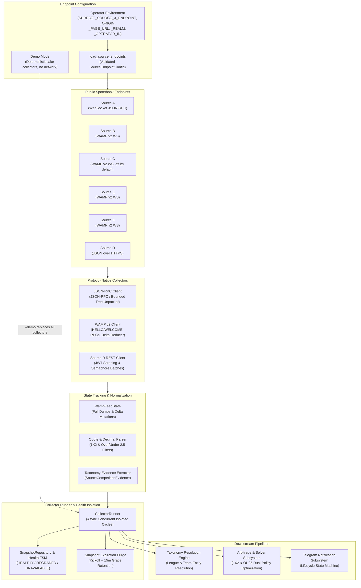
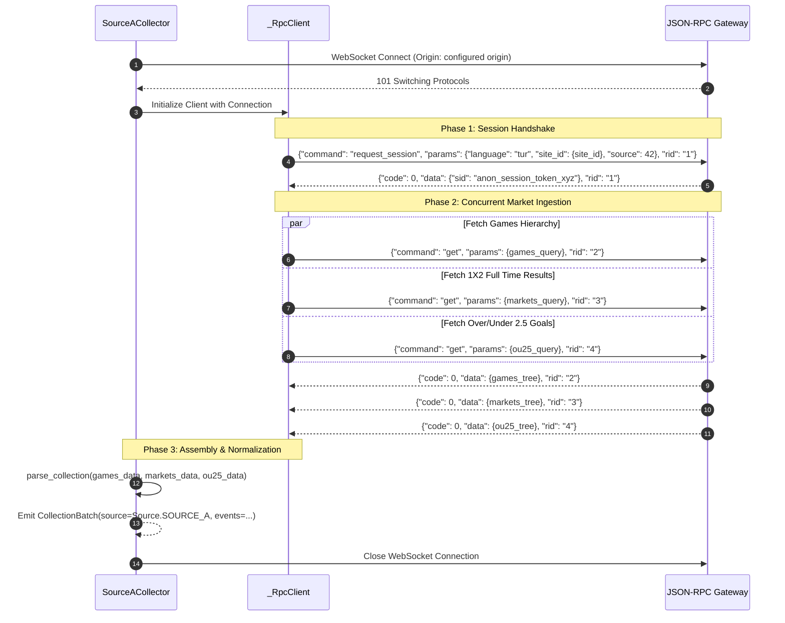
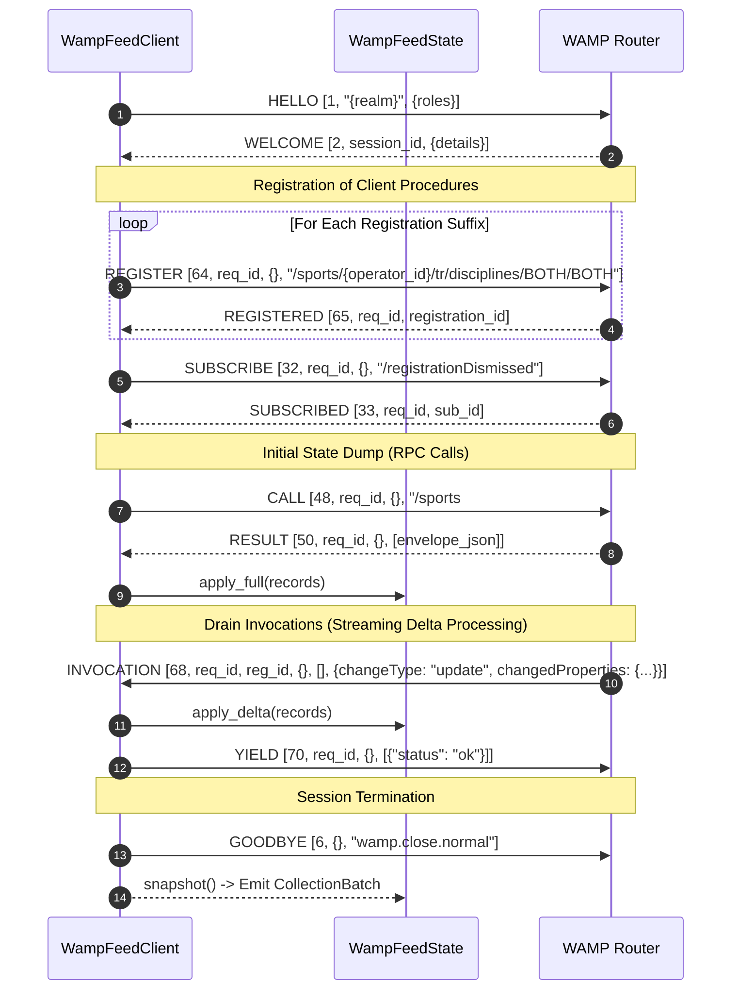
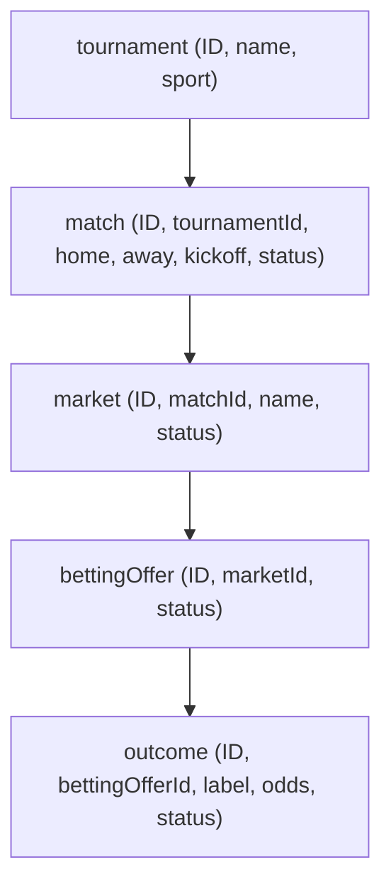
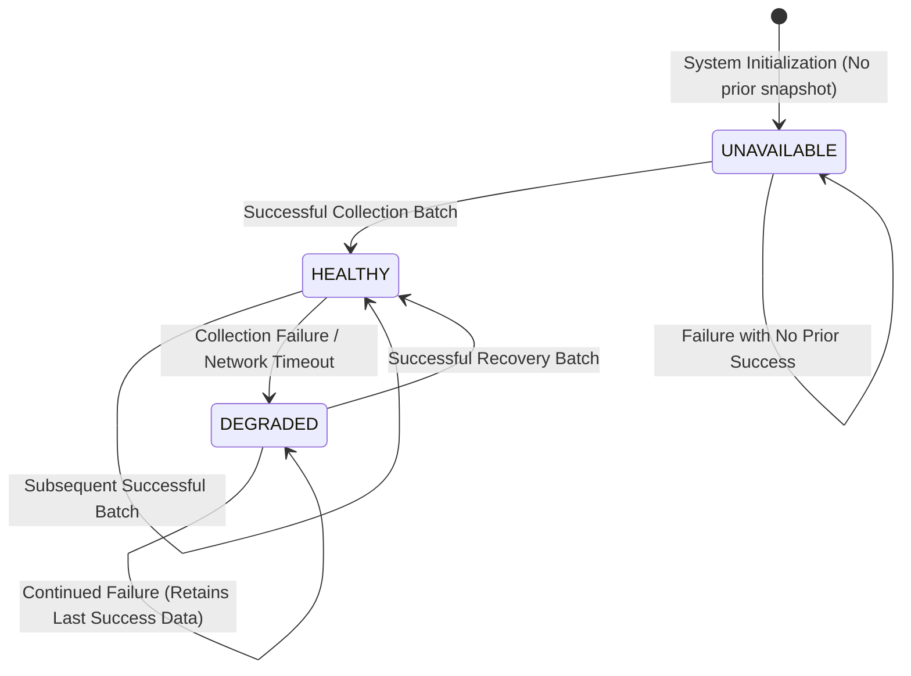

# Collectors & Protocols Subsystem Guide (`docs/architecture/03-collectors-and-protocols.md`)

> **Subsystem Role:** Real-time ingestion, protocol decoding, state reduction, endpoint configuration, and health tracking across target bookmaker endpoints into canonical, source-neutral pre-match market snapshots.

---

## 1. Architectural Overview & Ingestion Philosophy

The collectors and protocols subsystem is the entry point of the `surebet-analyzer` data pipeline. It continuously monitors live and pre-match market odds across disparate sportsbooks, translating proprietary bookmaker transport protocols into immutable, strongly typed, source-neutral domain events.



### 1.1 Pure Analytical Ingestion Boundary (Zero-Bet Invariant)

As strictly defined in [AGENTS.md](../../AGENTS.md):

> **⚠️ ZERO-BET INVARIANT (Strict Read-Only Policy)**  
> This application is strictly a **read-only analytical aggregator and decision-support calculator**.

Under **no circumstances** does any collector or protocol module:
- Authenticate with private customer betting accounts or submit login credentials.
- Retain betting cookies, session tokens for wagering, or player account identifiers.
- Interact with bet slip endpoints, ticket staging APIs, or placement mechanics.
- Execute deposits, withdrawals, promotional activations, or rollover claims.

All network interactions in this subsystem connect exclusively to **anonymous, unauthenticated, public sports market data endpoints** exposed by bookmakers to anonymous web visitors.

### 1.2 Anti-Pattern: The Zero-Browser Mandate

A foundational architectural invariant of `surebet-analyzer` is the **strict prohibition of headless browser automation** in production collection loops.

| Metric / Dimension | Headless Browser Automation | Protocol-Native Ingestion (`surebet-analyzer`) |
|---|---|---|
| **Latency** | 2,500 ms – 8,000 ms per page render | **< 10 ms** per WebSocket message frame |
| **CPU Utilization** | High (Layout tree, CSS calculations, Blink/V8 DOM) | **Near zero** (Pure streaming JSON parsing) |
| **Memory Footprint** | 300 MB – 1,000 MB per browser context | **< 20 MB** resident Python memory per collector |
| **Market Scope** | Limited to visible DOM viewport (~20–50 matches) | **Entire sportsbook catalog** (Thousands of markets concurrently) |
| **Update Mechanism** | Polling DOM or intercepting DevTools CDP frames | **Native WebSocket push streams & differential deltas** |
| **Bot Detection Risk** | Frequent Cloudflare / PerimeterX browser challenges | **Standard public WebSocket client handshake** |
| **Concurrency** | 3–5 concurrent browsers exhaust server hardware | **Dozens of concurrent connections** running on minimal VPS |

By reverse-engineering and implementing the underlying binary and JSON protocols used by the bookmakers' own Single Page Applications (SPAs), `surebet-analyzer` achieves microsecond-level market processing efficiency while consuming negligible system resources.

---

## 2. WebSocket JSON-RPC Protocol (Source A)

Source A exposes its sports catalog via the proprietary **WebSocket JSON-RPC protocol**. The feed is a bi-directional, stateful, JSON-RPC-style messaging protocol running over persistent WebSockets.

### 2.1 Transport Architecture & Framing Limits

- **Endpoint:** Read from `SUREBET_SOURCE_A_ENDPOINT` (`wss://<endpoint>`); see [Section 5](#5-endpoint-configuration--demo-mode).
- **Origin Header:** Required by the JSON-RPC gateway. Read from `SUREBET_SOURCE_A_ORIGIN`, defaulting to `https://<endpoint-host>`.
- **Site ID:** `request_session` is scoped to the operator's site id, read from `SUREBET_SOURCE_A_OPERATOR_ID`; without it the collector fails with `SourceEndpointNotConfigured`.
- **Frame Size Cap:** `_MAX_FRAME_BYTES = 5 * 1024 * 1024` (5 MB) to guard against packet flood denial of service.
- **Recursion Limits:** The JSON-RPC response structure is an arbitrarily nested dictionary tree. Parsing enforces `_MAX_DEPTH = 32` and `_MAX_CONTAINERS = 50_000` to prevent stack overflow and memory exhaustion attacks.

### 2.2 Handshake Sequence & Session Negotiation

The JSON-RPC protocol requires session initialization prior to servicing data queries. The client tracks outstanding RPC calls using a monotonic request identifier (`rid`).



### 2.3 Query Formulation (`protocol.py`)

Requests specify query projections via `what` (fields to return) and filters via `where`.

#### 1. Pre-Match Soccer Fixtures Query (`build_games_query`)
Ingests football competitions, regions, and matches while excluding live games and blocked fixtures:

```json
{
  "command": "get",
  "params": {
    "source": "betting",
    "what": {
      "sport": ["id", "name", "alias"],
      "region": ["id", "name", "alias"],
      "competition": ["id", "name"],
      "game": [
        "id",
        "team1_name",
        "team2_name",
        "start_ts",
        "is_blocked",
        "sport_alias"
      ]
    },
    "where": {
      "sport": {"alias": "Soccer"},
      "game": {
        "@or": [
          {"visible_in_prematch": 1},
          {"type": {"@in": [0, 2]}}
        ]
      }
    }
  },
  "rid": "2"
}
```

#### 2. Full-Time Result (1X2) Market Query (`build_markets_query`)
Directly targets the primary match winner market (`P1XP2`):

```json
{
  "command": "get",
  "params": {
    "source": "betting",
    "what": {
      "sport": ["id"],
      "region": ["id"],
      "competition": ["id"],
      "game": ["id"],
      "market": ["id", "name", "type", "display_key"],
      "event": ["id", "type_1", "price"]
    },
    "where": {
      "sport": {"alias": "Soccer"},
      "game": {
        "@or": [
          {"visible_in_prematch": 1},
          {"type": {"@in": [0, 2]}}
        ]
      },
      "market": {
        "type": "P1XP2",
        "display_key": "WINNER",
        "display_sub_key": "MATCH"
      }
    }
  },
  "rid": "3"
}
```

#### 3. Total Goals (Over/Under 2.5) Market Query (`build_ou25_query`)
Extracts the 2-way Over/Under 2.5 goals market (`type="OverUnder"`, `base=2.5`):

```json
{
  "command": "get",
  "params": {
    "source": "betting",
    "what": {
      "sport": ["id"],
      "region": ["id"],
      "competition": ["id"],
      "game": ["id"],
      "market": ["id", "name", "type", "base"],
      "event": ["id", "type_1", "price"]
    },
    "where": {
      "sport": {"alias": "Soccer"},
      "game": {
        "@or": [
          {"visible_in_prematch": 1},
          {"type": {"@in": [0, 2]}}
        ]
      },
      "market": {
        "type": "OverUnder",
        "base": 2.5
      }
    }
  },
  "rid": "4"
}
```

### 2.4 Tree Unpacking & Normalization Logic

JSON-RPC groups entities hierarchically:
```
data -> sport -> {sport_id} -> region -> {region_id} -> competition -> {comp_id} -> game -> {game_id} -> market -> {market_id} -> event -> {event_id}
```

In [`src/surebet/sources/source_a/protocol.py`](../../src/surebet/sources/source_a/protocol.py):
1. **Tree Traversal (`_walk`, `_entities`):** Safe bounded iterative stack traversal flattening dictionary key-value containers.
2. **Outcome Mapping:**
   - `W1` $\rightarrow$ `Outcome.HOME`
   - `X` $\rightarrow$ `Outcome.DRAW`
   - `W2` $\rightarrow$ `Outcome.AWAY`
   - `Over` $\rightarrow$ `TwoWayOutcome.OVER`
   - `Under` $\rightarrow$ `TwoWayOutcome.UNDER`
3. **Decimal Price Sanitization (`_decimal_price`):** Floats are rejected to enforce zero floating-point representation. Prices must be valid strings, integers, or `Decimal` values strictly greater than $1.0$.
4. **Kickoff Timestamp Resolution:** Converted from Unix epoch integer (`start_ts`) into UTC timezone-aware `datetime`. Past-kickoff fixtures are discarded immediately.
5. **Taxonomy Evidence Capture:** Region alias/name and competition id/name are extracted into `SourceCompetitionEvidence` for cross-bookmaker entity resolution.

---

## 3. WAMP v2 Protocol (Source B, Source C, Source E, Source F)

Source B, Source C, Source E, and Source F share one feed engine that speaks **WAMP v2**. Source B and Source C share one backend and publish identical prices, so Source C is disabled by default. The communication substrate is the **WAMP v2 (Web Application Messaging Protocol)** standard over WebSockets, using the `wamp.2.json` subprotocol.

### 3.1 WAMP v2 Architecture & Message Specifications

WAMP v2 unifies Routed Remote Procedure Calls (RPC) and Publish/Subscribe (PubSub) into JSON array frames where the first element is an integer message type code:

```
[MESSAGE_TYPE, ...PAYLOAD_ARGUMENTS]
```

The supported WAMP message types implemented in [`src/surebet/sources/wamp_feed/protocol.py`](../../src/surebet/sources/wamp_feed/protocol.py) and [`client.py`](../../src/surebet/sources/wamp_feed/client.py) include:

| Type Code | WAMP Message | Direction | Purpose in Collector |
|---|---|---|---|
| **1** | `HELLO` | Client $\to$ Router | Initiates session specifying realm and client roles |
| **2** | `WELCOME` | Router $\to$ Client | Confirms session establishment with session ID |
| **3** | `ABORT` | Router $\to$ Client | Protocol violation or gateway shutdown notification |
| **6** | `GOODBYE` | Bidirectional | Clean session termination signal (`wamp.close.normal`) |
| **8** | `ERROR` | Router $\to$ Client | Identifies failed RPC calls, registrations, or subscriptions |
| **32** | `SUBSCRIBE` | Client $\to$ Router | Subscribes to broadcast topics (e.g., `/registrationDismissed`) |
| **33** | `SUBSCRIBED` | Router $\to$ Client | Acknowledges subscription with subscription ID |
| **36** | `EVENT` | Router $\to$ Client | Real-time event publication dispatch |
| **48** | `CALL` | Client $\to$ Router | RPC call invocation (`/sports#initialDump`, etc.) |
| **50** | `RESULT` | Router $\to$ Client | Returns result of successful RPC invocation |
| **64** | `REGISTER` | Client $\to$ Router | Registers client callback procedure for server push |
| **65** | `REGISTERED` | Router $\to$ Client | Acknowledges procedure registration with registration ID |
| **68** | `INVOCATION` | Router $\to$ Client | Server calls registered client procedure with delta updates |
| **70** | `YIELD` | Client $\to$ Router | Client returns acknowledgment result (`{"status": "ok"}`) |

### 3.2 Per-Source Operator Configuration

The WAMP feed identifies each operator by a WAMP realm and a numeric operator id. Neither is hard-coded: [`WampFeedSourceConfig.from_endpoint`](../../src/surebet/sources/wamp_feed/models.py) builds the per-source contract from the environment (see [Section 5](#5-endpoint-configuration--demo-mode)):

- **WebSocket URL:** `SUREBET_<SOURCE>_ENDPOINT` (`wss://<endpoint>`)
- **Origin Header:** `SUREBET_<SOURCE>_ORIGIN`
- **Realm:** `SUREBET_<SOURCE>_REALM`, sent in `HELLO`
- **Operator ID:** `SUREBET_<SOURCE>_OPERATOR_ID`, substituted into every procedure and topic path (`/sports/<operator_id>/...`)
- **Session Handshake:**
  ```json
  [1, "<realm>", {"roles": {"caller": {}, "callee": {}, "publisher": {}, "subscriber": {}}}]
  ```

### 3.3 The Inverted Push Pattern (Client Procedure Registration)

Unlike standard REST or query-based WebSockets, the WAMP feed employs an **inverted push architecture**: the client registers procedure endpoints on the server using `REGISTER` (type 64). When sports markets update, the server invokes the client's registered procedures via `INVOCATION` (type 68).



### 3.4 State Reducer & Delta Reduction (`WampFeedState`)

Because market updates stream asynchronously during the collection window, [`src/surebet/sources/wamp_feed/state.py`](../../src/surebet/sources/wamp_feed/state.py) maintains an in-memory entity graph indexed by `(entity_type, entity_id)`:

1. **Initial Dump (`apply_full`):** Populates the base state from `/sports#initialDump` and `/sports#marketGroupsOverview`.
2. **Streaming Delta Application (`apply_delta`):**
   - `create` / `add`: Inserts new entity records merged with `changedProperties`.
   - `update` / `change`: Merges differential properties into the existing entity record in-place.
   - `delete` / `remove`: Evicts the record from the state map.
3. **Snapshot Isolation (`snapshot`):** Produces an immutable, detached dictionary snapshot of all entities for downstream parsing.

### 3.5 Graph Assembly & Quote Parsing (`parser.py`)

The WAMP feed structures match markets as a relational entity graph:


In [`src/surebet/sources/wamp_feed/parser.py`](../../src/surebet/sources/wamp_feed/parser.py):
- **1X2 Normalization:** Outgoing labels `"1"`, `"x"`, `"2"` map to `Outcome.HOME`, `Outcome.DRAW`, and `Outcome.AWAY`.
- **OU25 Normalization:** Outgoing labels `"Over"`, `"Under"` under 2.5 goals markets map to `TwoWayOutcome.OVER` and `TwoWayOutcome.UNDER`.
- **Decimal Odds Quantization:** Odds with excessive precision (reciprocal provider values) are conservatively rounded down to 4 decimal places (`_LIVE_ODDS_QUANTUM = Decimal("0.0001")`, `ROUND_DOWN`).

---

## 4. WAMP Feed Adapter Reuse & Source D

### 4.1 WAMP Feed Adapter Reuse (Source B, Source C, Source E, Source F)

The four WAMP-feed sources share one engine. Rather than duplicating protocol logic, each adapter (for example [`src/surebet/sources/source_e/collector.py`](../../src/surebet/sources/source_e/collector.py)) wraps the generic WAMP feed collector and differs only in the environment prefix it reads:

```python
class SourceECollector:
    REGISTRATION_SUFFIXES = REGISTRATION_SUFFIXES

    def __init__(self, *, endpoint_config=None, timeout_seconds=20.0, ...):
        endpoint = endpoint_config or load_source_endpoints(Source.SOURCE_E)
        self._config = WampFeedSourceConfig.from_endpoint(endpoint)
```

### 4.2 Source D (JSON over HTTPS)

Source D is a second sportsbook backend of the Source A operator (`Source.SOURCE_D`). It is served through an anonymous JSON-over-HTTPS API rather than the WebSocket JSON-RPC feed, implemented in [`src/surebet/sources/source_d/`](../../src/surebet/sources/source_d/).

1. **Anonymous Token Refresh (`client.py`):**
   - The client requests the API root under `SUREBET_SOURCE_D_ENDPOINT`. If no tokens are present, it loads the public page configured as `SUREBET_SOURCE_D_PAGE_URL`, follows the embedded sportsbook iframe, and retries.
   - Regular expressions extract anonymous authentication tokens; a `403` response triggers one token refresh:
     ```python
     _INTERNAL_TOKEN_RE = re.compile(r"'internalToken':'([^']+)'")
     _SESSION_TOKEN_RE = re.compile(r"'sessionToken':'([^']+)'")
     ```
2. **Chunked REST Ingestion (`collector.py`):**
   - Queries public match listings and market groups in chunks of 25 fixtures (`_BATCH_CHUNK_SIZE = 25`).
   - Uses an asynchronous semaphore (`_MAX_CONCURRENT_REQUESTS = 6`) to prevent rate-limiting while pulling odds.

---

## 5. Endpoint Configuration & Demo Mode

The repository ships no provider hosts. Whoever runs a collector supplies each source's endpoint through environment variables, read by [`load_source_endpoints`](../../src/surebet/sources/endpoints.py). Nothing about a source's address is stored in the database or editable from the web UI.

### 5.1 Environment Variables

Each source reads keys under the prefix `SUREBET_<SOURCE>_` (for example `SUREBET_SOURCE_A_`, `SUREBET_SOURCE_E_`):

| Variable | Required | Meaning |
|---|---|---|
| `SUREBET_<SOURCE>_ENDPOINT` | Yes | WebSocket (`wss://<endpoint>`) or HTTPS API base URL |
| `SUREBET_<SOURCE>_ORIGIN` | No | Origin header sent with the handshake; defaults to `https://<endpoint-host>` |
| `SUREBET_<SOURCE>_PAGE_URL` | No | Public page that hands out anonymous tokens (Source D); defaults to the origin |
| `SUREBET_<SOURCE>_REALM` | WAMP-feed sources | WAMP realm sent in `HELLO` |
| `SUREBET_<SOURCE>_OPERATOR_ID` | WAMP-feed sources, Source A | Positive integer operator id used in WAMP feed procedure and topic paths, and as the JSON-RPC `site_id` of Source A's `request_session` |

The values are validated into an immutable `SourceEndpointConfig`:

```python
@dataclass(frozen=True, slots=True)
class SourceEndpointConfig:
    source: Source
    page_url: str
    websocket_url: str
    origin: str
    realm: str | None = None
    operator_id: int | None = None
```

- **Security Sanitization:** Only absolute `https://` or `wss://` URLs are accepted; surrounding whitespace and embedded userinfo/credentials are rejected, and `operator_id` must be a positive integer.
- **Missing Endpoint:** A source without `SUREBET_<SOURCE>_ENDPOINT` raises `SourceEndpointNotConfigured` (a `SourceUnavailable` subclass) when it is collected. `CollectorRunner` records it like any other source failure, so the health page shows `endpoint not configured (SUREBET_SOURCE_A_ENDPOINT)` while the other sources keep running.
- **Where to Set Them:** In the server `.env` file read by Docker Compose (see [deployment.md](../deployment.md)), or in the shell for one-shot CLI commands such as `collect-wamp`.

### 5.2 Demo Mode

`uv run surebet-web serve --demo --db demo.db` replaces every collector with deterministic fake collectors from [`src/surebet/demo/`](../../src/surebet/demo/). No source is contacted and no endpoint variable is needed.

- Each demo source prices every fixture from the same fair probabilities with its own margin and a small, stable per-outcome wobble, so most matches show the negative margin of a real market. A handful of fixtures carry an edge where one source overprices an outcome; only those clear zero and appear as opportunities.
- Source C stays off, as in a default deployment.
- A `demo` login is created with a random password that is printed on every start, so the full UI can be explored offline without any credential in the repository.

---

## 6. Health Monitoring, Fault Isolation & Lifecycle Management

The collection subsystem must remain resilient against network blips, missing endpoint configuration, and bookmaker downtime without failing the entire platform or polluting downstream analytics.

### 6.1 Source Health State Machine

The status of each source is managed as a finite state machine stored in the `source_snapshots` table:



The three discrete statuses in `SourceHealthStatus` ([`src/surebet/storage/snapshots.py`](../../src/surebet/storage/snapshots.py)):
1. `HEALTHY`: The most recent collection completed successfully within deadlines.
2. `DEGRADED`: The most recent collection failed (e.g., timeout, connection refused), but a previously successful snapshot exists. Downstream consumers (e.g., `LifecycleEngine`) can detect this state to suppress alerts or hold notifications rather than abruptly terminating opportunities.
3. `UNAVAILABLE`: The source failed and has never produced a successful snapshot. A source whose endpoint is not configured stays here, with `endpoint not configured (...)` as its last error.

### 6.2 Snapshot Retention & Purge Policy

Over time, completed sporting events become stale. To maintain minimal database footprint and eliminate zombie opportunities:
- `SnapshotRepository.purge_expired(now, grace=timedelta(minutes=15))`
- Events whose `kickoff + grace` is earlier than the current UTC time are safely pruned from `events_json`.
- Pruning operates purely on the snapshot payload; health audit logs and taxonomy mappings remain intact.

### 6.3 Collector Runner Architecture (`collector_runner.py`)

[`CollectorRunner`](../../src/surebet/web/collector_runner.py) orchestrates the asynchronous collection loop:

```python
class CollectorRunner:
    """Coordinates periodic and on-demand concurrent collection with source isolation."""
```

Key architectural capabilities:
1. **Source Fault Isolation:** Each source runs inside an independent `try/except` boundary. If Source A times out, Source C, Source B, and Source E continue uninterrupted:
   ```python
   async def _collect_source(self, source: Source, func: CollectorFunc) -> None:
       try:
           batch = await func()
           await asyncio.to_thread(self._persist_source_batch, source, batch, duration_ms)
       except Exception as error:  # Source boundary isolation
           self._snapshot_repo.record_failure(source=source, error_message=str(error), ...)
   ```
2. **Concurrent Execution:** Sources are polled concurrently using `asyncio.gather(*tasks, return_exceptions=True)`.
3. **Manual Cooldown Protection:** Protects against thundering herd attacks from web UI refreshes via a monotonic cooldown guard (`cooldown_seconds = 10.0`).
4. **Post-Cycle Hooks:** Once all sources settle:
   - Purges expired fixtures (`purge_expired`).
   - Cleans up expired auth sessions and rate limit records.
   - Triggers the Telegram notification cycle (`_notification_cycle(now)`).
5. **Periodic Background Loop:** Background task sleeps for `refresh_interval_seconds` (configurable via `SystemSettingsRepository`) and gracefully handles task cancellation.

---

## 7. Canonical Data Models & Downstream Integration

All sportsbook adapters normalize raw JSON frames into standard, immutable domain models defined in [`src/surebet/sources/models.py`](../../src/surebet/sources/models.py).

### 7.1 CollectedEvent & CollectionBatch Invariants

```python
class CollectedEvent(DomainModel):
    source: Source
    source_event_id: StrictStr
    competition: StrictStr
    home: StrictStr
    away: StrictStr
    kickoff: datetime
    market_key: Literal["football.full_time_result.90m"]
    quotes: Mapping[Outcome, Quote]
    ou25_quotes: Mapping[TwoWayOutcome, Quote] | None = None
    source_competition: SourceCompetitionEvidence | None = None
```

Strict structural invariants enforced by Pydantic validators:
- **Timezone Awareness:** `kickoff` must be a timezone-aware UTC datetime.
- **Identity Invariants:** `source_event_id`, `competition`, `home`, and `away` must be non-empty strings.
- **Market Completeness:**
  - `quotes` must contain exactly the three outcomes: `Outcome.HOME`, `Outcome.DRAW`, and `Outcome.AWAY`.
  - `ou25_quotes` (if present) must contain exactly `TwoWayOutcome.OVER` and `TwoWayOutcome.UNDER`.
- **Cross-Source Consistency:** Every `Quote.source` and `Quote.event_id` must match the parent event's `source` and `source_event_id`.

```python
class CollectionBatch(DomainModel):
    source: Source
    started_at: datetime
    finished_at: datetime
    events: tuple[CollectedEvent, ...]
```

### 7.2 Taxonomy Observation Hook

During batch persistence, `CollectorRunner` extracts competition metadata (`SourceCompetitionEvidence`) and dispatches it to `TaxonomyRepository.observe_batch`. This enables the taxonomy subsystem to continuously discover new leagues, map provider aliases, and maintain unresolved entity queues without human intervention.

---

## 8. Subsystem File Map & Testing Strategy

### 8.1 Source Code Map

| File Path | Subsystem Responsibility | Key Classes / Functions |
|---|---|---|
| [`src/surebet/sources/models.py`](../../src/surebet/sources/models.py) | Canonical data models & validators | `CollectedEvent`, `CollectionBatch`, `SourceUnavailable` |
| [`src/surebet/sources/endpoints.py`](../../src/surebet/sources/endpoints.py) | Environment endpoint loading & validation | `SourceEndpointConfig`, `load_source_endpoints`, `SourceEndpointNotConfigured` |
| [`src/surebet/sources/schedule.py`](../../src/surebet/sources/schedule.py) | Monotonic drift-corrected scheduling loop | `watch_collections` |
| [`src/surebet/sources/source_a/protocol.py`](../../src/surebet/sources/source_a/protocol.py) | WebSocket JSON-RPC query builder & tree parser | `build_games_query`, `build_markets_query`, `parse_collection` |
| [`src/surebet/sources/source_a/collector.py`](../../src/surebet/sources/source_a/collector.py) | Anonymous async WebSocket JSON-RPC client | `SourceACollector`, `_RpcClient` |
| [`src/surebet/sources/wamp_feed/protocol.py`](../../src/surebet/sources/wamp_feed/protocol.py) | WAMP v2 message framing & type decoding | `encode_hello`, `decode_frame`, `WampFeedProtocolError` |
| [`src/surebet/sources/wamp_feed/client.py`](../../src/surebet/sources/wamp_feed/client.py) | Correlated async WAMP v2 client | `WampFeedClient`, `Invocation` |
| [`src/surebet/sources/wamp_feed/collector.py`](../../src/surebet/sources/wamp_feed/collector.py) | WAMP feed collection lifecycle orchestrator | `collect_snapshot`, `_collect_full_records`, `_drain_invocations` |
| [`src/surebet/sources/wamp_feed/parser.py`](../../src/surebet/sources/wamp_feed/parser.py) | Relational entity graph joining & quote parser | `parse_envelope`, `parse_v2_records`, `parse_live_records` |
| [`src/surebet/sources/wamp_feed/state.py`](../../src/surebet/sources/wamp_feed/state.py) | Connection-scoped entity reducer & deltas | `WampFeedState`, `apply_full`, `apply_delta` |
| [`src/surebet/sources/source_c/collector.py`](../../src/surebet/sources/source_c/collector.py) | Source C source adapter | `SourceCCollector` |
| [`src/surebet/sources/source_b/collector.py`](../../src/surebet/sources/source_b/collector.py) | Source B source adapter | `SourceBCollector` |
| [`src/surebet/sources/source_e/collector.py`](../../src/surebet/sources/source_e/collector.py) | Source E source adapter | `SourceECollector` |
| [`src/surebet/sources/source_f/collector.py`](../../src/surebet/sources/source_f/collector.py) | Source F source adapter | `SourceFCollector` |
| [`src/surebet/sources/source_d/collector.py`](../../src/surebet/sources/source_d/collector.py) | Source D JSON-over-HTTPS collector | `SourceDCollector` |
| [`src/surebet/demo/`](../../src/surebet/demo/) | Deterministic offline collectors & demo login | `DemoCollector`, `demo_collector_funcs`, `seed_demo_account` |
| [`src/surebet/storage/snapshots.py`](../../src/surebet/storage/snapshots.py) | SQLite snapshot repo & health FSM tracking | `SnapshotRepository`, `SourceHealth`, `SourceHealthStatus` |
| [`src/surebet/web/collector_runner.py`](../../src/surebet/web/collector_runner.py) | Multi-source concurrent coordinator & loop | `CollectorRunner` |

### 8.2 Testing Strategy & Verification Suite

The collectors subsystem is comprehensively covered by isolated unit and integration tests using offline fixtures and mocked transports:

```bash
# Run all collector and protocol unit tests
uv run pytest tests/unit/sources/ -o pythonpath=.

# Run WAMP feed protocol and client tests
uv run pytest tests/unit/sources/wamp_feed/ -o pythonpath=.

# Run Source A JSON-RPC protocol tests
uv run pytest tests/unit/sources/source_a/ -o pythonpath=.

# Run CollectorRunner orchestration and health isolation tests
uv run pytest tests/unit/web/test_collector_runner.py -o pythonpath=.

# Run demo mode tests
uv run pytest tests/unit/demo/ -o pythonpath=.
```

| Test File Path | Key Scenarios Verified |
|---|---|
| [`tests/unit/sources/wamp_feed/test_client.py`](../../tests/unit/sources/wamp_feed/test_client.py) | Out-of-order WAMP `CALL`/`RESULT` correlation, `INVOCATION`/`YIELD` handshakes, error handling |
| [`tests/unit/sources/wamp_feed/test_parser.py`](../../tests/unit/sources/wamp_feed/test_parser.py) | Entity graph assembly, 1X2 and OU25 quote extraction, decimal quantization, malformed payload resilience |
| [`tests/unit/sources/wamp_feed/test_state.py`](../../tests/unit/sources/wamp_feed/test_state.py) | Full snapshot loading, differential delta updates (`create`, `update`, `delete`), immutable isolation |
| [`tests/unit/sources/source_a/test_protocol.py`](../../tests/unit/sources/source_a/test_protocol.py) | Bounded recursive JSON-RPC traversal, JSON query format verification, quote normalization against offline fixtures |
| [`tests/unit/sources/test_endpoints.py`](../../tests/unit/sources/test_endpoints.py) | Environment prefix derivation, missing endpoint reported as a source failure, origin and page URL defaults, unsafe URL and operator id rejection |
| [`tests/unit/web/test_collector_runner.py`](../../tests/unit/web/test_collector_runner.py) | Source failure isolation, `SourceHealthStatus` transitions, concurrency bounds, cooldown enforcement |
| [`tests/unit/demo/test_demo.py`](../../tests/unit/demo/test_demo.py) | Valid future batches for every demo source, stable prices across cycles, idempotent demo account seeding, positive and negative margins in the demo app |
