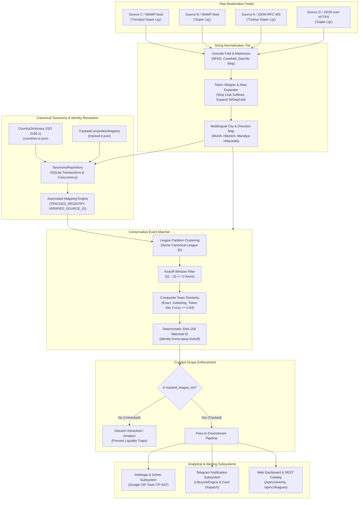
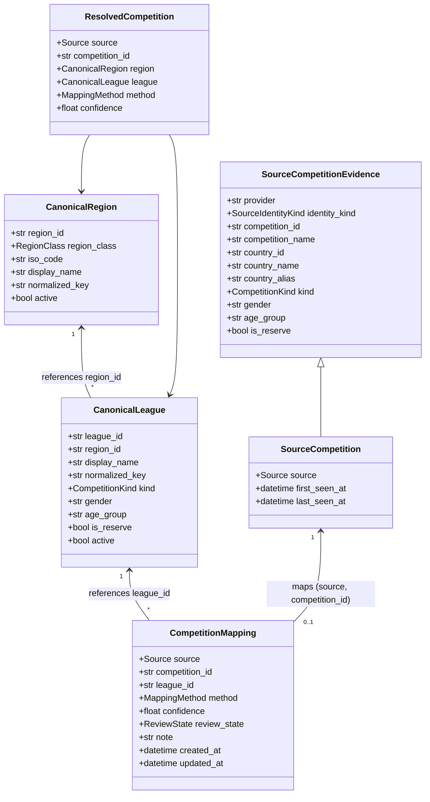
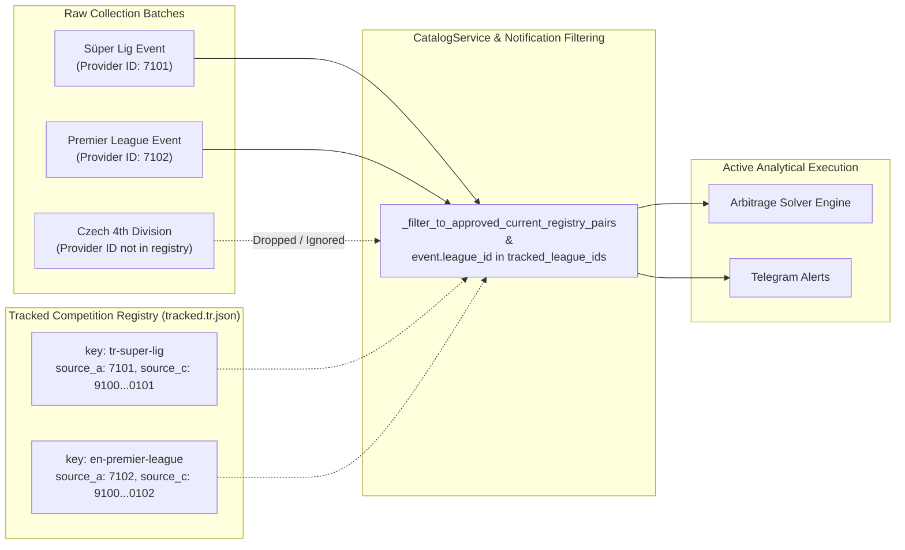
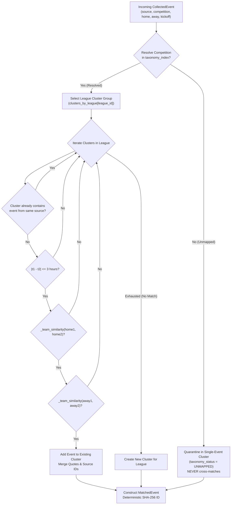
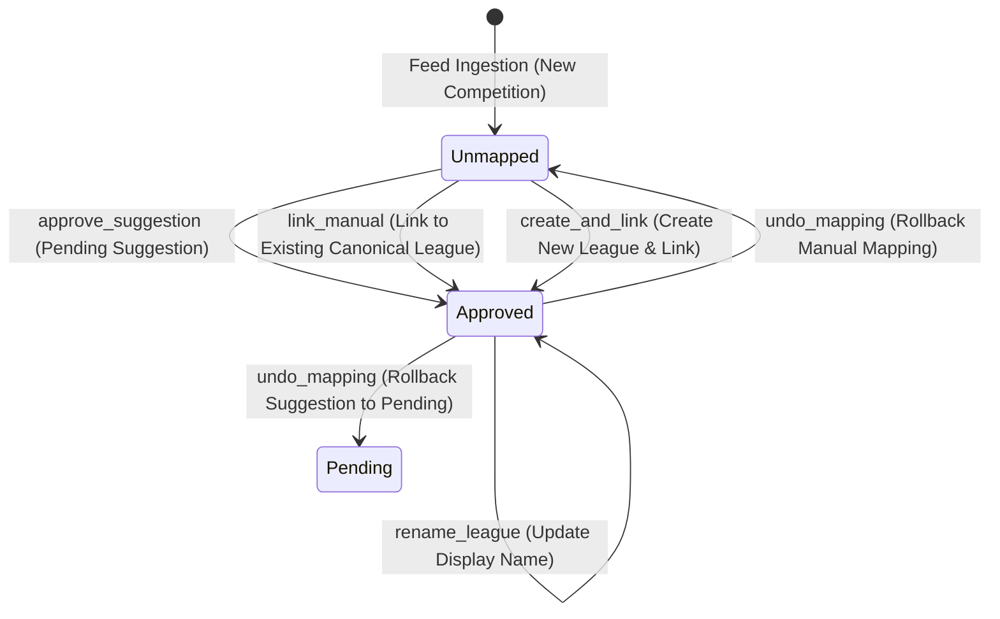

# Taxonomy & Matching Subsystem Guide (`docs/architecture/04-taxonomy-and-matching.md`)

> **Subsystem Role:** Multi-source taxonomy normalization, canonical entity resolution, curated scope filtering, conservative cross-bookmaker event matching, and optimistic-concurrency admin review.

---

## 1. Architectural Overview & System Purpose

The `surebet-analyzer` taxonomy and matching subsystem reconciles heterogeneous, noisy, and uncoordinated sports competition and event feeds into a unified canonical catalog. Because sportsbooks operate on disparate naming conventions, language locales, tournament structures, and transliteration standards, mathematical arbitrage calculations cannot proceed until raw events are definitively resolved into identical real-world matches.



### 1.1 The Cross-Bookmaker Entity Resolution Challenge

In multi-bookmaker aggregation, sportsbooks rarely agree on naming or taxonomy conventions:
- **League Variations:** One bookmaker publishes `"Trendyol Süper Lig"`, another `"Türkiye - Süper Lig"`, another `"Turkey: Super Lig"`, and another `"TUR 1"`.
- **Turkish Diacritics & Dotted/Dotless I:** Turkish orthography distinguishes `"I"` (dotless capital, lowercase `"ı"`) from `"İ"` (dotted capital, lowercase `"i"`). Standard English case-folding (`"İ".lower()` -> `"i\u0307"`) introduces combining diacritics that cause naive string comparisons to fail.
- **Club Suffixes & Legal Forms:** Sportsbooks append or omit legal entities and club designations: `"Fenerbahçe SK"`, `"Galatasaray A.Ş."`, `"Besiktas JK"`, `"Real Madrid CF"`, `"AS Monaco"`, `"Paris Saint-Germain (PSG)"`.
- **Multilingual City Names & Translations:** Sportsbooks localize foreign cities into Turkish or vice versa: `"FC Bayern München"` vs `"FC Bayern Münih"` vs `"Bayern Munich"`; `"Rapid Wien"` vs `"Rapid Viyana"`; `"Spartak Moskova"` vs `"Spartak Moscow"`.
- **False-Match Traps (Homonyms & Subdivisions):** A competition named `"Premier League"` exists in England, Scotland, Russia, Ukraine, and the United States. Without strict country-level scoping, an English match could erroneously match an American lower-league fixture. Similarly, reserve squads (`Sporting CP B`, `Sporting II`) and youth tournaments (`U19`, `U21`) must never collide with senior teams.

### 1.2 Strict Read-Only Analytical Policy (Zero-Bet Invariant)

As mandated across this repository and defined in [AGENTS.md](../../AGENTS.md):
- **Purely Analytical Resolution:** The taxonomy and event matching pipeline operates solely to align and normalize read-only market data.
- **Zero Bet Placement:** No component of the taxonomy, matching, or review system places bets, automates ticket submission, or interfaces with private betting accounts.
- **Integrity Boundary:** The resolution engine serves strictly as a decision-support foundation for downstream mathematical solvers and operator notifications.

### 1.3 Decoupling & Invariant Principles

The subsystem enforces four foundational architectural invariants:
1. **Conservative Clustering (Zero False Positive Tolerance):** It is vastly preferable to fail to match two genuine events (yielding two isolated, single-source events) than to create an erroneous cross-source cluster. A false match produces "phantom arbitrage" with catastrophic consequences for manual wagers.
2. **Strict League Partitioning:** Cross-source event matching occurs **only within the same resolved canonical league**. Unmapped events are strictly quarantined and never match across bookmakers.
3. **One Event Per Source Invariant:** A matched event cluster can never contain more than one event from any single bookmaker.
4. **Deterministic Identity:** The unique identifier of a matched event (`matched_id`) is a cryptographically deterministic SHA-256 hash of its canonical league identity, normalized team names, and UTC kickoff date.

---

## 2. String Normalization Pipeline

The normalization pipeline converts volatile raw bookmaker strings into uniform, lowercased, ASCII-folded tokens while preserving critical lexical distinctions. The pipeline is split into two specialized modules:
- [`src/surebet/matching/normalizer.py`](../../src/surebet/matching/normalizer.py): Aggressive transliteration, club token stripping, multilingual city mapping, and abbreviation expansion for team names and match competitions.
- [`src/surebet/taxonomy/normalizer.py`](../../src/surebet/taxonomy/normalizer.py): Conservative Unicode NFKC folding and Turkish-aware collation ranking for canonical competition persistence and UI sorting.

### 2.1 Unicode Normalization & Turkish-Aware Folding

Standard Unicode normalization decomposes accented glyphs, but Turkish dotted/dotless I requires dedicated handling:

```python
def normalize_taxonomy_text(value: str) -> str:
    """Build a comparison key without removing semantic qualifier words."""
    normalized = unicodedata.normalize("NFKC", value).casefold().replace("i\u0307", "i")
    words = "".join(
        " " if character.isspace() or unicodedata.category(character).startswith("P") else character
        for character in normalized
    )
    return " ".join(words.split())
```

When standard `casefold()` is applied to Turkish uppercase `"İ"`, Python yields `"i\u0307"` (lowercase `i` followed by Unicode combining dot above `U+0307`). The pipeline immediately replaces `"i\u0307"` with standard ASCII `"i"`.

### 2.2 Character Translation Map (`_CHAR_MAP`) & ASCII Folding

For team and tournament names in [`src/surebet/matching/normalizer.py`](../../src/surebet/matching/normalizer.py), `_ascii_fold` applies an explicit `str.maketrans` mapping covering Turkish, Nordic, German, and Slavic characters before Unicode decomposition:

```python
_CHAR_MAP = str.maketrans(
    {
        # Turkish
        "ç": "c",
        "Ç": "c",
        "ğ": "g",
        "Ğ": "g",
        "ı": "i",
        "İ": "i",
        "ö": "o",
        "Ö": "o",
        "ş": "s",
        "Ş": "s",
        "ü": "u",
        "Ü": "u",
        # Nordic / Scandinavian
        "ø": "o",
        "Ø": "o",
        "æ": "ae",
        "Æ": "ae",
        "œ": "oe",
        "Œ": "oe",
        "å": "a",
        "Å": "a",
        # German
        "ß": "ss",
        # Slavic / Polish / Baltic
        "ł": "l",
        "Ł": "l",
        "đ": "d",
        "Đ": "d",
    }
)


def _ascii_fold(text: str) -> str:
    translated = text.translate(_CHAR_MAP)
    normalized = unicodedata.normalize("NFKD", translated)
    ascii_only = normalized.encode("ascii", "ignore").decode("ascii")
    return ascii_only.lower()
```

### 2.3 Turkish Alphabet Collation & Sort Keys (`turkish_sort_key`)

In the web interface and API, sports competitions must sort according to standard Turkish alphabetical order:
$$\text{A, B, C, Ç, D, E, F, G, Ğ, H, I, İ, J, K, L, M, N, O, Ö, P, R, S, Ş, T, U, Ü, V, Y, Z}$$

Critically, dotless `I` / `ı` and dotted `İ` / `i` occupy different collation ranks. To align Python backend API responses with the frontend's `Intl.Collator("tr-TR", { sensitivity: "base" })`, [`src/surebet/taxonomy/normalizer.py`](../../src/surebet/taxonomy/normalizer.py) defines a deterministic rank collation key:

```python
_TURKISH_ALPHABET = "ABCÇDEFGĞHIİJKLMNOÖPRSŞTUÜVYZ"
_TURKISH_LETTER_RANK = {letter: rank for rank, letter in enumerate(_TURKISH_ALPHABET)}

_TURKISH_LOWER_TO_UPPER = {
    "a": "A",
    "b": "B",
    "c": "C",
    "ç": "Ç",
    "d": "D",
    "e": "E",
    "f": "F",
    "g": "G",
    "ğ": "Ğ",
    "h": "H",
    "ı": "I",
    "i": "İ",
    "j": "J",
    "k": "K",
    "l": "L",
    "m": "M",
    "n": "N",
    "o": "O",
    "ö": "Ö",
    "p": "P",
    "r": "R",
    "s": "S",
    "ş": "Ş",
    "t": "T",
    "u": "U",
    "ü": "Ü",
    "v": "V",
    "y": "Y",
    "z": "Z",
}
for _lower, _upper in _TURKISH_LOWER_TO_UPPER.items():
    _TURKISH_LETTER_RANK[_lower] = _TURKISH_LETTER_RANK[_upper]
```

Characters outside the Turkish alphabet (digits, non-Turkish symbols) fall back to their ordinal values shifted past `_TURKISH_FALLBACK_BASE`.

### 2.4 Token Stripping, Abbreviation Expansion & Word Mapping

Team name normalization in [`normalize_team_name`](../../src/surebet/matching/normalizer.py) executes a sequential multi-stage transformation:

1. **Parenthetical & Bracket Removal:** Strips supplemental metadata such as `"(PSG)"`, `"[W]"`, `"(Altyapı)"`.
2. **Dotted Legal Abbreviation Stripping:** Cleans dotted forms (`a.ş.`, `f.c.`, `s.k.`, `u.d.`, `c.f.`) before general punctuation stripping destroys word boundaries.
3. **Common Abbreviation Expansion:**
   - `\bst\.?\b` $\to$ `saint` (e.g., `St. Johnstone` $\to$ `saint johnstone`)
   - `\bdep\.?\b` $\to$ `deportivo` (e.g., `Dep La Coruna` $\to$ `deportivo la coruna`)
   - `\butd\.?\b` $\to$ `united` (e.g., `Sheffield Utd` $\to$ `sheffield united`)
   - `\bwed\.?\b` $\to$ `wednesday` (e.g., `Sheffield Wed` $\to$ `sheffield wednesday`)
4. **Punctuation Removal:** Strips all non-alphanumeric and non-whitespace characters (`re.compile(r"[^\w\s]")`).
5. **Multilingual Word & City Translation (`_WORD_MAP`):** Translates regional city names and tokens into standard normalized forms:
   - `munih`, `munchen` $\to$ `munich`
   - `viyana`, `wien` $\to$ `vienna`
   - `marsilya` $\to$ `marseille`
   - `moskova` $\to$ `moscow`
   - `bukres` $\to$ `bucuresti`
   - `atina` $\to$ `athens`
   - `sofya` $\to$ `sofia`
   - `prag`, `praha` $\to$ `prague`
   - `lozan` $\to$ `lausanne`
   - `strazburg` $\to$ `strasbourg`
   - `lizbon` $\to$ `lisbon`
   - `dynamo` $\to$ `dinamo`
   - `bati` $\to$ `west`, `sehir` / `sehri` $\to$ `city`, `guney` $\to$ `south`, `kutukleri` $\to$ `timbers`
6. **Club Token Stripping (`_STRIP_TOKENS`):** Removes generic club affixes:
   `sk`, `fk`, `fc`, `jk`, `as`, `kulubu`, `kulub`, `spor`, `cf`, `ac`, `sc`, `bsc`, `sv`, `vfl`, `tsv`, `vfb`, `cd`, `ud`, `sd`, `istanbul`, `afc`, `nfc`, `bk`, `if`, `ff`, `ik`, `pfk`.
7. **Team Alias Dictionary Lookup (`_TEAM_ALIASES`):** Canonicalizes common irregular nicknames and brand contractions:
   - `inter milan`, `internazionale` $\to$ `inter`
   - `ac milan` $\to$ `milan`
   - `paris sg`, `psg` $\to$ `paris saint germain`
   - `man united` $\to$ `manchester united`
   - `man city` $\to$ `manchester city`
   - `qpr` $\to$ `queens park rangers`
   - `wolves` $\to$ `wolverhampton`
   - `sporting cp`, `sporting lizbon`, `sporting lisbon` $\to$ `sporting`
   - `sporting cp b`, `sporting lizbon ii` $\to$ `sporting b`
   - `guney tirol`, `south tirol` $\to$ `sudtirol`

### 2.5 Competition Normalization (`normalize_competition`)

When resolving competition labels, [`normalize_competition`](../../src/surebet/matching/normalizer.py):
1. Folds ASCII and strips country prefixes (e.g., `"Türkiye - "`, `"İngiltere - "`, `"Turkey: "`).
2. Removes commercial title sponsors: `"trendyol"`, `"barclays"`, `"ea sports"`, `"santander"`.
3. Resolves known major tournament aliases:
   - `super lig`, `superlig` $\to$ `"super lig"`
   - `champions league`, `sampiyonlar ligi` $\to$ `"uefa champions league"`
   - `europa league`, `avrupa ligi` $\to$ `"uefa europa league"`
   - `conference league`, `konferans ligi` $\to$ `"uefa conference league"`
   - `premier league`, `premier lig` $\to$ `"premier league"`
   - `la liga`, `laliga`, `primera division` $\to$ `"la liga"`
   - `serie a` $\to$ `"serie a"`
   - `bundesliga` $\to$ `"bundesliga"`
   - `ligue 1` $\to$ `"ligue 1"`

### 2.6 Normalization Sample Matrix

The following table demonstrates real-world input strings transformed by the pipeline:

| Category | Raw Source Input | Normalized Output | Applied Transformations |
|---|---|---|---|
| **Turkish Club** | `"Fenerbahçe SK"` | `"fenerbahce"` | Turkish `ç` $\to$ `c`, strip club suffix `sk` |
| **Turkish Club** | `"Galatasaray A.Ş."` | `"galatasaray"` | Strip abbreviation `a.ş.`, Turkish char fold |
| **Turkish Club** | `"Trabzonspor Kulübü"` | `"trabzonspor"` | Turkish `ü` $\to$ `u`, strip suffix `kulubu` |
| **European Club** | `"FC Bayern München"` | `"bayern munich"` | Strip `fc`, `munchen` $\to$ `munich`, umlaut fold |
| **European Club** | `"FC Bayern Münih"` | `"bayern munich"` | Strip `fc`, Turkish translation `munih` $\to$ `munich` |
| **European Club** | `"Paris Saint-Germain (PSG)"` | `"paris saint germain"` | Remove `(PSG)`, hyphen $\to$ space |
| **European Club** | `"PSG"` | `"paris saint germain"` | Expanded via `_TEAM_ALIASES` |
| **European Club** | `"AS Monaco"` | `"monaco"` | Strip prefix `as` |
| **European Club** | `"Dep La Coruna"` | `"deportivo la coruna"` | Abbreviation expansion `dep` $\to$ `deportivo` |
| **Nordic Club** | `"Lillestrøm"` | `"lillestrom"` | Nordic `ø` $\to$ `o` |
| **Nordic Club** | `"SønderjyskE"` | `"sonderjyske"` | Nordic `ø` $\to$ `o`, lowercasing |
| **German Club** | `"SC Preußen Münster"` | `"preussen munster"` | German `ß` $\to$ `ss`, `ü` $\to$ `u`, strip `sc` |
| **Slavic Club** | `"Jagiellonia Białystok"` | `"jagiellonia bialystok"` | Polish `ł` $\to$ `l` |
| **Austrian Club** | `"Rapid Viyana"` | `"rapid vienna"` | Turkish translation `viyana` $\to$ `vienna` |
| **Austrian Club** | `"FK Austria Wien"` | `"austria vienna"` | German `wien` $\to$ `vienna`, strip `fk` |
| **Russian Club** | `"Spartak Moskova"` | `"spartak moscow"` | Turkish translation `moskova` $\to$ `moscow` |
| **Romanian Club** | `"Dinamo Bükreş"` | `"dinamo bucuresti"` | Turkish translation `bukres` $\to$ `bucuresti` |
| **Greek Club** | `"AEK Atina"` | `"aek athens"` | Turkish translation `atina` $\to$ `athens` |
| **Czech Club** | `"Slavia Prag"` | `"slavia prague"` | Translation `prag` $\to$ `prague` |
| **Portuguese Club** | `"Sporting Lizbon"` | `"sporting"` | Translation + alias canonicalization |
| **Reserve Squad** | `"Sporting Lizbon II"` | `"sporting b"` | Mapped to distinct reserve entity |
| **English Club** | `"Sheffield Utd"` | `"sheffield united"` | Abbreviation expansion `utd` $\to$ `united` |
| **English Club** | `"Wolves"` | `"wolverhampton"` | Nickname alias resolution |
| **English Club** | `"QPR"` | `"queens park rangers"` | Acronym expansion via `_TEAM_ALIASES` |
| **Tournament** | `"Trendyol Süper Lig"` | `"super lig"` | Strip sponsor `Trendyol`, alias fold |
| **Tournament** | `"Türkiye - Süper Lig"` | `"super lig"` | Strip country prefix, alias fold |
| **Tournament** | `"UEFA Şampiyonlar Ligi"` | `"uefa champions league"` | Turkish tournament alias mapping |

---

## 3. Canonical Taxonomy Model & Identity Resolution

The taxonomy model structures sports competitions into formal entities managed by [`src/surebet/taxonomy/models.py`](../../src/surebet/taxonomy/models.py) and persisted via [`src/surebet/storage/taxonomy.py`](../../src/surebet/storage/taxonomy.py).



### 3.1 Domain Models & Enums

#### Key Enums
- **`CompetitionKind`:** `league`, `cup`, `qualifier`, `friendly`, `international_club`, `international_national`, `unknown`.
- **`RegionClass`:** `country`, `international`, `unknown`.
- **`SourceIdentityKind`:**
  - `PROVIDER_ID`: Stable, machine-readable identifier assigned by the bookmaker (e.g., WAMP-feed tournament ID `"910000000000000101"`, Source A competition ID `"7101"`).
  - `DERIVED_TEXT`: Unstructured text derived from breadcrumbs or event strings (e.g., `"text:super-lig"`).
- **`MappingMethod`:**
  - `MANUAL`: Verified and linked explicitly by human operator.
  - `TRACKED_REGISTRY`: Matched via the curated `TrackedCompetitionRegistry`.
  - `VERIFIED_SOURCE_ID`: Automatically mapped via unambiguous provider evidence and signature match.
  - `EXACT_ALIAS`: Matched via an approved entry in `league_aliases`.
  - `SUGGESTION`: Heuristic match generated by the system, awaiting operator review.
- **`ReviewState`:** `approved`, `pending`, `conflict`.
- **`TaxonomyStatus`:**
  - `VERIFIED`: The competition is successfully mapped to an approved `CanonicalLeague`. Eligible for cross-bookmaker event matching and arbitrage calculation.
  - `UNMAPPED`: Incomplete or unreviewed competition. Quarantined from cross-bookmaker matching.

### 3.2 Country & Region Resolution (`CountryDictionary`)

Country resolution maps bookmaker country strings, ISO codes, and aliases into canonical `CanonicalRegion` instances. It is powered by [`CountryDictionary`](../../src/surebet/taxonomy/normalizer.py) and packaged with Turkish country aliases in [`src/surebet/taxonomy/countries.tr.json`](../../src/surebet/taxonomy/countries.tr.json):

```json
{
  "iso_code": "TR",
  "display_name": "Türkiye",
  "aliases": ["TR", "Türkiye", "Turkey", "Turkiye"]
}
```

- **Validation:** Country regions enforce `region_id == f"country:{iso_code}"`, where `iso_code` must exist in the standard ISO 3166-1 alpha-2 frozen set (`_ISO_ALPHA2_CODES`).
- **Special Regions:** International and multi-country tournaments use `region:international` or `region:unknown` with `iso_code = None`.
- **Ambiguity Detection:** If an incoming competition provides contradictory country labels (e.g., `country_name="Spain"` but `country_alias="Italy"`), the resolver marks the evidence as `AMBIGUOUS_COUNTRY` and halts automatic mapping.

### 3.3 Automated Mapping Rules (`_auto_map`)

When a sportsbook emits an observation with `SourceIdentityKind.PROVIDER_ID`, [`TaxonomyRepository.observe`](../../src/surebet/storage/taxonomy.py) attempts automatic mapping:

1. **Tracked Registry Check:** The repository first queries `TrackedCompetitionRegistry`. If the provider ID is in the curated registry, it is mapped with `MappingMethod.TRACKED_REGISTRY` and approved immediately.
2. **Country Resolution:** Resolves `(country_id, country_name, country_alias)` against `CountryDictionary`. If zero or more than one region resolves, auto-mapping halts and leaves the item unmapped.
3. **Existing Manual Protection:** If an existing mapping with `MappingMethod.MANUAL` exists, automated logic never overwrites it.
4. **Signature Lookup:** Computes a `LeagueSignature(normalized_name, kind, gender, age_group, is_reserve)`:
   - Queries `canonical_leagues` for an exact match within the resolved region.
   - If exactly one league matches: mapped with `MappingMethod.VERIFIED_SOURCE_ID`.
   - If no direct league matches: queries `league_aliases`. If exactly one matches: mapped with `MappingMethod.EXACT_ALIAS`.
   - If no match exists anywhere: dynamically creates a new `CanonicalLeague` (with a generated `league:<uuid4>` identifier) and registers an initial alias, mapping it with `MappingMethod.VERIFIED_SOURCE_ID`.
5. **Auditing:** Every automated mapping writes an audit record into `taxonomy_audit` with `actor = "system"`.

### 3.4 Optimistic Concurrency Control

Because operators curate taxonomy through the web dashboard while collector daemons run in the background, concurrent edits could cause stale overwrites. The subsystem implements strict optimistic concurrency:
- Every mutable operation requires the caller to supply `expected_updated_at`.
- If the current database record's `updated_at` does not match `expected_updated_at`:
  ```python
  def _expect(actual: str, expected: datetime) -> None:
      if datetime.fromisoformat(actual) != _aware(expected):
          raise TaxonomyConflict("taxonomy record changed")
  ```
- The Web API translates `TaxonomyConflict` into `HTTP 409 Conflict`, prompting the operator's browser to reload the latest state before retrying.

---

## 4. Curated Scope & Tracked Leagues (`tracked_league_ids`)

A common flaw in naive arbitrage scanners is attempting to scrape and solve every obscure sports event worldwide. In practice, amateur, youth, and lower-tier leagues represent severe operational hazards:
- **Liquidity Deficits:** Bookmakers allow tiny maximum stakes (e.g., 50 TL) on low-tier matches.
- **Palpable Errors & Voids:** Odds fluctuations on niche leagues often trigger bookmaker "palpable error" rules, resulting in voided legs and catastrophic unhedged risk.
- **Account Limiting:** Betting on obscure matches flags accounts for immediate stake restriction or closure.

`surebet-analyzer` solves this through an explicit, operator-curated boundary: **the Curated Scope**.



### 4.1 Tracked Competition Registry (`tracked.tr.json`)

The curated catalog is defined in [`src/surebet/taxonomy/tracked.tr.json`](../../src/surebet/taxonomy/tracked.tr.json) and managed by [`TrackedCompetitionRegistry`](../../src/surebet/taxonomy/tracked.py):

```json
{
  "version": "2026-10-23",
  "competitions": [
    {
      "key": "tr-super-lig",
      "region_id": "country:TR",
      "display_name": "Türkiye Süper Lig",
      "sources": {
        "source_a": "7101",
        "source_b": "910000000000000101",
        "source_c": "910000000000000101",
        "source_d": "8101",
        "source_e": "910000000000000101",
        "source_f": "910000000000000101"
      }
    },
    {
      "key": "en-premier-league",
      "region_id": "country:GB",
      "display_name": "İngiltere Premier Lig",
      "sources": {
        "source_a": "7102",
        "source_b": "910000000000000102",
        "source_c": "910000000000000102",
        "source_d": "8102",
        "source_e": "910000000000000102",
        "source_f": "910000000000000102"
      }
    }
  ]
}
```

### 4.2 Filtering Mechanics Across the Pipeline

1. **Ingestion-Time Filtering (`CatalogService`):**
   In [`src/surebet/catalog/service.py`](../../src/surebet/catalog/service.py), `build_snapshot` invokes `_filter_to_approved_current_registry_pairs`:
   ```python
   approved_current_pairs = self._taxonomy_repo.approved_current_registry_pairs()
   batches = _filter_to_approved_current_registry_pairs(raw_batches, approved_current_pairs)
   ```
   Events whose `(source, competition_id)` pair is not currently approved in the tracked registry are discarded before matching begins.
2. **Snapshot Scope Enforcement:**
   When `tracked_only=True` is requested, the snapshot trims matched events and active leagues:
   ```python
   tracked = self._taxonomy_repo.tracked_league_ids()
   matched_events = tuple(event for event in matched_events if event.league_id in tracked)
   leagues = tuple(league for league in leagues if league.league_id in tracked)
   ```
3. **Notification Engine Enforcement:**
   In [`src/surebet/notifications/service.py`](../../src/surebet/notifications/service.py), the Telegram alerting cycle evaluates **only** candidate events where `event.league_id in tracked_league_ids`:
   ```python
   candidate_events = [
       event
       for event in matched_events
       if event.league_id in tracked_league_ids
       and (wanted_countries is None or event.country_id in wanted_countries)
       and (wanted_leagues is None or event.league_id in wanted_leagues)
   ]
   ```

---

## 5. Cross-Bookmaker Event Matching

Once raw events are ingested and their competitions resolved, [`src/surebet/matching/matcher.py`](../../src/surebet/matching/matcher.py) aggregates cross-bookmaker events into unified `MatchedEvent` structures.



### 5.1 The Composite Matching Algorithm (`match_events`)

The event clustering algorithm processes incoming events sequentially:

1. **Taxonomy Index Lookup:**
   For each event, `evidence = event.source_competition` is checked against `taxonomy_index: Mapping[tuple[Source, str], ResolvedCompetition]`.
   - If unmapped: The event is immediately segregated into its own isolated cluster.
   - If resolved: The event enters the cluster list for `resolved.league.league_id`.
2. **League Partitioning:**
   Events are evaluated **only** against clusters sharing the exact same `league_id`. This prevents clubs with identical names in different countries or different divisions from ever clustering together.
3. **One Event Per Source Check:**
   If a prospective cluster already contains an event from `event.source`, the candidate is rejected for that cluster.
4. **Kickoff Time Window:**
   Kickoff timestamps are converted to UTC. The absolute time delta must not exceed 3 hours (`_MAX_KICKOFF_DELTA = timedelta(hours=3)`):
   $$|t_1 - t_2| \le 3 \text{ hours}$$
   This accommodates timezone reporting discrepancies and daylight saving differences across sportsbooks while preventing matches between identical teams across different matchdays from colliding.
5. **Team Similarity Verification:**
   Both home and away teams must satisfy `_team_similarity`. If both match, the event is added to the cluster.

### 5.2 Team Similarity Logic (`_team_similarity`)

Team name matching evaluates four progressive heuristic stages:

```python
def _team_similarity(norm1: str, norm2: str) -> bool:
    # 1. Exact match
    if norm1 == norm2:
        return True

    # 2. Substring containment (minimum length 4)
    if len(norm1) >= 4 and (norm1 in norm2 or norm2 in norm1):
        return True

    # 3. Token set subset intersection
    set1 = set(norm1.split())
    set2 = set(norm2.split())
    if bool(set1) and bool(set2) and (set1.issubset(set2) or set2.issubset(set1)):
        return True

    # 4. High-threshold fuzzy similarity for slight transliterations / typos (len >= 5)
    if len(norm1) >= 5 and len(norm2) >= 5:
        if SequenceMatcher(None, norm1, norm2).ratio() >= 0.84:
            return True

    return False
```

- **Substring Containment:** Matches `"galatasaray"` with `"galatasaray istanbul"`.
- **Token Set Inclusion:** Matches `"west brom"` with `"west bromwich albion"`.
- **Fuzzy Ratio Threshold ($\ge 0.84$):** Accommodates minor transliteration differences (e.g., `"fenerbahce"` vs `"fenebahce"`) while rejecting different clubs (e.g., `"liverpool"` vs `"blackpool"` fails with ratio $0.56$).

### 5.3 Deterministic Identity Generation (`_make_matched_id`)

Every `MatchedEvent` requires an immutable, globally unique identifier that remains stable across aggregation cycles:

```python
def _make_matched_id(identity: str, home: str, away: str, kickoff: datetime) -> str:
    utc_kickoff = kickoff.astimezone(UTC).strftime("%Y-%m-%d")
    raw = f"{identity}:{home}:{away}:{utc_kickoff}".lower()
    return hashlib.sha256(raw.encode("utf-8")).hexdigest()[:16]
```

- **`identity`:** Either `resolved.league.league_id` (for verified events) or `f"unmapped:{source}:{source_event_id}"` (for unmapped events).
- **Date Granularity:** Formatted as `YYYY-MM-DD` UTC to prevent minute-level kickoff adjustments from mutating the event ID.
- **Hash Output:** The first 16 hexadecimal characters of the SHA-256 digest.

### 5.4 Display Priority Ordering

When bookmakers format team names slightly differently (e.g., `"Galatasaray A.Ş."` vs `"Galatasaray"`), the matcher selects canonical display names using a fixed priority order:

```python
_SOURCE_DISPLAY_PRIORITY: dict[Source, int] = {
    Source.SOURCE_C: 0,  # Preferred: Cleanest WAMP-feed taxonomy
    Source.SOURCE_B: 1,  # Secondary: Clean WAMP-feed taxonomy
    Source.SOURCE_A: 2,  # Tertiary: JSON-RPC WS text strings
    Source.SOURCE_D: 3,  # Quaternary: JSON-over-HTTPS strings
}
```

The event from the highest-priority bookmaker supplies the primary `home`, `away`, and `competition` labels for user presentation.

### 5.5 The `MatchedEvent` Domain Model

The output of the matcher is an immutable, frozen Pydantic model:

```python
class MatchedEvent(BaseModel):
    model_config = ConfigDict(frozen=True)

    matched_id: StrictStr
    taxonomy_status: TaxonomyStatus
    competition: StrictStr
    country_id: StrictStr | None
    country_name: StrictStr | None
    country_iso_code: StrictStr | None
    league_id: StrictStr | None
    league_name: StrictStr | None
    home: StrictStr
    away: StrictStr
    kickoff: datetime
    source_events: Mapping[Source, StrictStr]  # Source -> source_event_id
    quotes: Mapping[tuple[Source, Outcome], Quote]  # 1X2 Full Time Quotes
    ou25_quotes: Mapping[tuple[Source, TwoWayOutcome], Quote]  # Over/Under 2.5 Quotes
```

---

## 6. Admin Curation & Review Workflow

Automated algorithms handle the vast majority of standard competitions, but irregular tournaments, regional youth leagues, and new sports require operator oversight. The web dashboard provides an administrative curation interface backed by transactional SQLite persistence in [`src/surebet/storage/taxonomy.py`](../../src/surebet/storage/taxonomy.py).

### 6.1 Relational SQLite Taxonomy Schema

```sql
CREATE TABLE IF NOT EXISTS canonical_regions (
    region_id TEXT PRIMARY KEY,
    region_class TEXT NOT NULL,
    iso_code TEXT,
    display_name TEXT NOT NULL,
    normalized_key TEXT NOT NULL,
    active INTEGER NOT NULL DEFAULT 1,
    created_at TEXT NOT NULL,
    updated_at TEXT NOT NULL
);

CREATE TABLE IF NOT EXISTS canonical_leagues (
    league_id TEXT PRIMARY KEY,
    region_id TEXT NOT NULL REFERENCES canonical_regions(region_id),
    display_name TEXT NOT NULL,
    normalized_key TEXT NOT NULL,
    kind TEXT NOT NULL,
    gender TEXT,
    age_group TEXT,
    is_reserve INTEGER,
    active INTEGER NOT NULL DEFAULT 1,
    created_at TEXT NOT NULL,
    updated_at TEXT NOT NULL
);

CREATE TABLE IF NOT EXISTS league_aliases (
    alias_id INTEGER PRIMARY KEY AUTOINCREMENT,
    league_id TEXT NOT NULL REFERENCES canonical_leagues(league_id) ON DELETE CASCADE,
    normalized_key TEXT NOT NULL,
    kind TEXT NOT NULL,
    gender TEXT,
    age_group TEXT,
    is_reserve INTEGER,
    UNIQUE (league_id, normalized_key, kind, gender, age_group, is_reserve)
);

CREATE TABLE IF NOT EXISTS source_competitions (
    source TEXT NOT NULL,
    competition_id TEXT NOT NULL,
    provider TEXT NOT NULL,
    identity_kind TEXT NOT NULL,
    competition_name TEXT NOT NULL,
    country_id TEXT,
    country_name TEXT,
    country_alias TEXT,
    season TEXT,
    kind TEXT NOT NULL,
    gender TEXT,
    age_group TEXT,
    is_reserve INTEGER,
    first_seen_at TEXT NOT NULL,
    last_seen_at TEXT NOT NULL,
    PRIMARY KEY (source, competition_id)
);

CREATE TABLE IF NOT EXISTS competition_mappings (
    source TEXT NOT NULL,
    competition_id TEXT NOT NULL,
    league_id TEXT NOT NULL REFERENCES canonical_leagues(league_id),
    method TEXT NOT NULL,
    confidence REAL NOT NULL CHECK (confidence >= 0 AND confidence <= 1),
    review_state TEXT NOT NULL,
    note TEXT,
    created_at TEXT NOT NULL,
    updated_at TEXT NOT NULL,
    PRIMARY KEY (source, competition_id),
    FOREIGN KEY (source, competition_id)
        REFERENCES source_competitions(source, competition_id) ON DELETE CASCADE
);

CREATE TABLE IF NOT EXISTS taxonomy_audit (
    audit_id INTEGER PRIMARY KEY AUTOINCREMENT,
    action TEXT NOT NULL,
    actor TEXT NOT NULL,
    occurred_at TEXT NOT NULL,
    before_json TEXT,
    after_json TEXT
);
```

### 6.2 Review Queue States & Conflict Indicators

Incoming items in the `/api/v1/mappings/unmatched` review queue are annotated with diagnostic conflict reasons:
- **`DERIVED_TEXT_IDENTITY`:** The competition identity was derived from unstructured text rather than an official provider ID. Requires manual verification.
- **`UNRESOLVED_COUNTRY`:** Neither `country_id`, `country_name`, nor `country_alias` could be matched in `CountryDictionary`.
- **`AMBIGUOUS_COUNTRY`:** Conflicting country labels were provided (e.g., multiple different ISO codes resolved).

### 6.3 Administrative Mutation Operations

The admin workflow supports five primary operations:



1. **`approve_suggestion` (`POST /api/v1/mappings/{source}/{competition_id}/approve`):**
   - Transitions a pending automated suggestion to `ReviewState.APPROVED`.
   - Verifies optimistic version `expected_updated_at`.
   - Validates country and competition kind compatibility.
   - Records audit event `approve_suggestion`.
2. **`link_manual` (`PUT /api/v1/mappings/{source}/{competition_id}/link`):**
   - Links a source competition to an existing canonical league.
   - Enforces strict semantic validation: country, competition kind, gender, age group, and reserve state must not contradict the source evidence.
   - Sets `MappingMethod.MANUAL`, `confidence = 1.0`, and `ReviewState.APPROVED`.
3. **`create_and_link` (`POST /api/v1/mappings/{source}/{competition_id}/league`):**
   - Creates a brand-new `CanonicalLeague` in SQLite and links the competition to it in a single transaction.
   - Adds an initial alias record in `league_aliases`.
4. **`rename_league` (`PATCH /api/v1/leagues/{league_id}`):**
   - Updates the display name and recomputes the `normalized_key`.
   - Preserves all associated competition mappings and aliases.
5. **`undo_mapping` (`DELETE /api/v1/mappings/{source}/{competition_id}`):**
   - If manual: completely deletes the mapping record, returning the competition to the unmapped queue.
   - If suggestion: resets `review_state` to `ReviewState.PENDING`.
   - Audits the deletion/rollback.

### 6.4 Web REST API Specification

All administrative taxonomy endpoints are secured via session cookies and CSRF tokens:

| HTTP Method & Path | Auth & CSRF | Request Schema | Response Schema | Description |
|---|---|---|---|---|
| `GET /api/v1/countries` | Session | None | `list[CountryItem]` | Lists canonical regions with active league, event, and opportunity counts. Sorted by Turkish collation. |
| `GET /api/v1/leagues` | Session | `region_id?: str` | `list[LeagueItem]` | Lists active canonical leagues with event and opportunity counts. |
| `GET /api/v1/mappings/unmatched` | Session | `limit=100`, `offset=0` | `list[UnmatchedItem]` | Returns unmapped or pending competitions in the operator review queue. |
| `GET /api/v1/mappings/mapped` | Session | `limit=100`, `offset=0` | `list[UnmatchedItem]` | Returns all actively approved competition mappings. |
| `POST /api/v1/mappings/{src}/{cid}/approve` | Session + CSRF | `ApproveRequest` | `MappingItem` | Approves a pending suggestion. |
| `PUT /api/v1/mappings/{src}/{cid}/link` | Session + CSRF | `LinkRequest` | `MappingItem` | Manually links a competition to a canonical league. |
| `POST /api/v1/mappings/{src}/{cid}/league` | Session + CSRF | `CreateLeagueRequest` | `MappingItem` | Creates a new canonical league and links the competition. |
| `PATCH /api/v1/leagues/{league_id}` | Session + CSRF | `RenameLeagueRequest` | `LeagueRecord` | Renames an existing canonical league. |
| `DELETE /api/v1/mappings/{src}/{cid}` | Session + CSRF | `expected_updated_at` query | `204 No Content` | Reverts an approved mapping. |

---

## 7. Subsystem File Map & Key Classes

| File Path | Component / Layer | Key Classes & Functions | Test Suite Coverage |
|---|---|---|---|
| [`src/surebet/taxonomy/models.py`](../../src/surebet/taxonomy/models.py) | Taxonomy Domain Models | `CanonicalRegion`, `CanonicalLeague`, `CompetitionKind`, `RegionClass`, `SourceCompetitionEvidence`, `SourceCompetition`, `CompetitionMapping`, `ResolvedCompetition`, `LeagueSignature` | [`tests/unit/taxonomy/test_taxonomy_models.py`](../../tests/unit/taxonomy/test_taxonomy_models.py) |
| [`src/surebet/taxonomy/normalizer.py`](../../src/surebet/taxonomy/normalizer.py) | Taxonomy Text Normalization | `normalize_taxonomy_text`, `turkish_sort_key`, `CountryDictionary` | [`tests/unit/taxonomy/test_taxonomy_normalizer.py`](../../tests/unit/taxonomy/test_taxonomy_normalizer.py) |
| [`src/surebet/taxonomy/tracked.py`](../../src/surebet/taxonomy/tracked.py) | Curated Scope Registry | `TrackedCompetition`, `TrackedCompetitionRegistry` | [`tests/unit/taxonomy/test_tracked.py`](../../tests/unit/taxonomy/test_tracked.py) |
| [`src/surebet/taxonomy/countries.tr.json`](../../src/surebet/taxonomy/countries.tr.json) | Packaged Data | Country ISO codes, Turkish names, and aliases | Tested via `CountryDictionary` |
| [`src/surebet/taxonomy/tracked.tr.json`](../../src/surebet/taxonomy/tracked.tr.json) | Packaged Data | Operator-curated competitions and bookmaker source IDs | Tested via `TrackedCompetitionRegistry` |
| [`src/surebet/matching/models.py`](../../src/surebet/matching/models.py) | Matched Event Models | `MatchedEvent` | Tested across matching and solver tests |
| [`src/surebet/matching/normalizer.py`](../../src/surebet/matching/normalizer.py) | Team & Competition Normalizer | `normalize_team_name`, `normalize_competition`, `_ascii_fold`, `_CHAR_MAP`, `_WORD_MAP`, `_TEAM_ALIASES` | [`tests/unit/matching/test_normalizer.py`](../../tests/unit/matching/test_normalizer.py) |
| [`src/surebet/matching/matcher.py`](../../src/surebet/matching/matcher.py) | Cross-Source Event Matcher | `match_events`, `_team_similarity`, `_events_match`, `_make_matched_id`, `_resolve_event` | [`tests/unit/matching/test_matcher.py`](../../tests/unit/matching/test_matcher.py) |
| [`src/surebet/storage/taxonomy.py`](../../src/surebet/storage/taxonomy.py) | SQLite Persistence & Admin Repo | `TaxonomyRepository`, `TaxonomyConflict`, `LeagueState` | [`tests/unit/storage/test_taxonomy.py`](../../tests/unit/storage/test_taxonomy.py) |
| [`src/surebet/storage/db.py`](../../src/surebet/storage/db.py) | Database Schema Migrations | DDL tables for taxonomy, leagues, regions, mappings, audit | Tested across all database tests |
| [`src/surebet/web/routes/mappings.py`](../../src/surebet/web/routes/mappings.py) | Admin Review Web API | Endpoints for `/api/v1/mappings/...` and `/api/v1/leagues/...` | [`tests/unit/web/test_api_taxonomy.py`](../../tests/unit/web/test_api_taxonomy.py) |
| [`src/surebet/web/routes/taxonomy.py`](../../src/surebet/web/routes/taxonomy.py) | Catalog Query Web API | Endpoints for `/api/v1/countries` and `/api/v1/leagues` | [`tests/unit/web/test_api_taxonomy.py`](../../tests/unit/web/test_api_taxonomy.py) |
